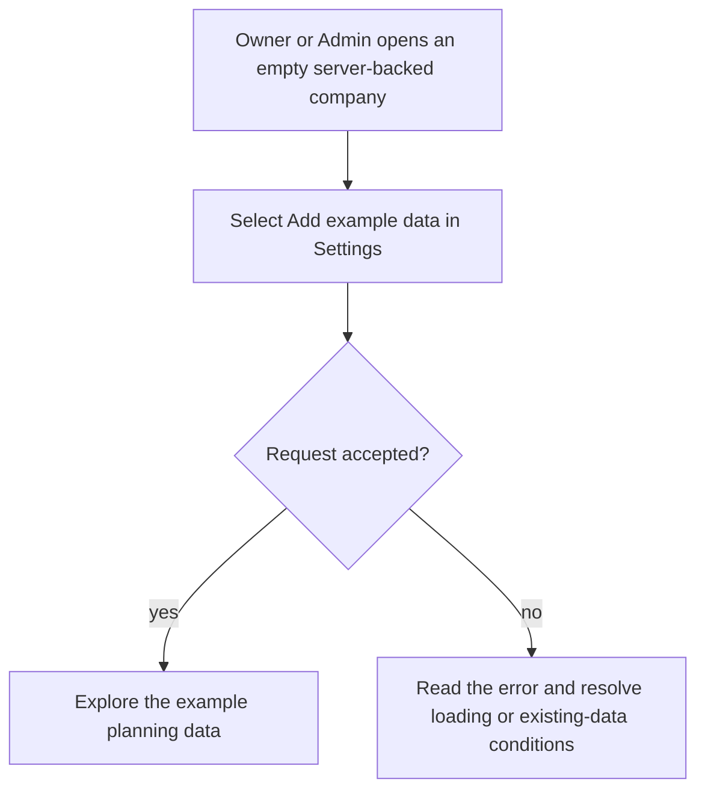
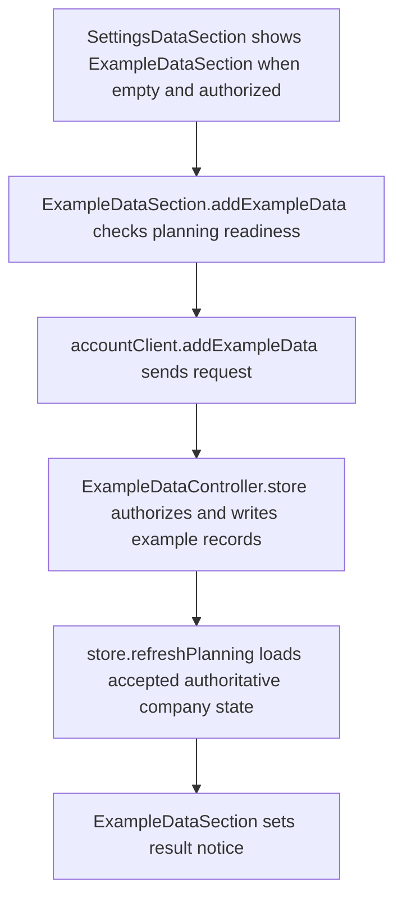

# US-SET-25 — Add example data

As an Owner or Admin, I want to add example data to an empty company so that I can explore a working setup.

**Status:** Current
**Access:** Owner, Admin
**Entry:** Settings → Data and support → Add example data
**Documentation:** [Settings](../../docs-src/using/settings.md)
**Source:** [SettingsDataSection.tsx](../../apps/frontend/src/components/settings/SettingsDataSection.tsx)

## Acceptance criteria

- **Add example data** is available to Owner/Admin on an empty server-backed company, excluding the built-in Internal client. It adds the fictional example dataset.
- The action is unavailable when company planning records already exist, including archived records.

## User flow

## Code flow

**Code references:** [SettingsDataSection.tsx](../../apps/frontend/src/components/settings/SettingsDataSection.tsx), [accountClient.ts](../../apps/frontend/src/account/accountClient.ts), [useStore.ts](../../apps/frontend/src/store/useStore.ts), [example_data_controller.ts](../../apps/backend/app/controllers/example_data_controller.ts)
