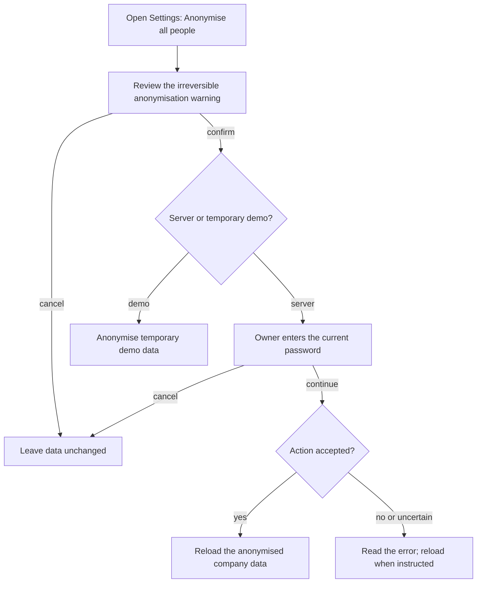
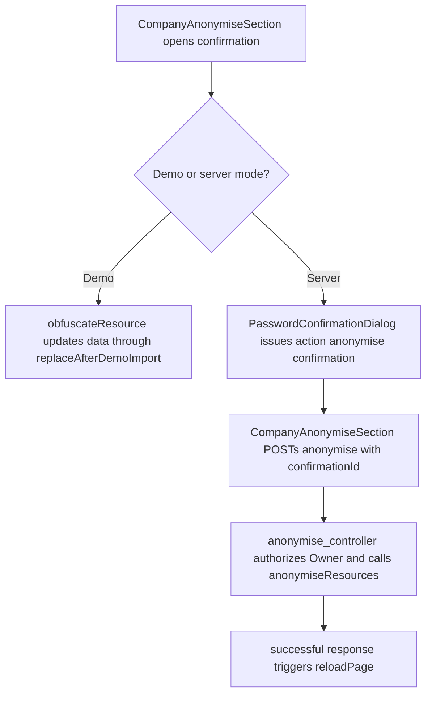

# US-SET-26 — Anonymise all people

As an Owner, I want to anonymise all people so that identifying details and dependent notes are removed company-wide.

**Status:** Current
**Access:** Owner on the server; demo users for temporary demo data.
**Entry:** Settings → Data and support → Anonymise all people
**Documentation:** [Settings](../../docs-src/using/settings.md)
**Source:** [CompanyAnonymiseSection.tsx](../../apps/frontend/src/components/settings/CompanyAnonymiseSection.tsx), [PasswordConfirmationDialog.tsx](../../apps/frontend/src/auth/PasswordConfirmationDialog.tsx)

## Acceptance criteria

| Field    | Control        | Required/default/conditions                                                                                      |
| -------- | -------------- | ---------------------------------------------------------------------------------------------------------------- |
| Password | Password input | Required after the confirmation step on the server; current Owner password. The temporary demo skips this field. |

- **Anonymise all people** opens confirmation; **Cancel** leaves data unchanged. Confirming continues to the password dialog on the server.
- **Continue** anonymises identifying resource details and dependent notes. Company, catalogue and membership records remain.

## User flow

## Code flow

**Code references:** [CompanyAnonymiseSection.tsx](../../apps/frontend/src/components/settings/CompanyAnonymiseSection.tsx), [PasswordConfirmationDialog.tsx](../../apps/frontend/src/auth/PasswordConfirmationDialog.tsx), [anonymise_controller.ts](../../apps/backend/app/controllers/anonymise_controller.ts), [anonymise.ts](../../apps/backend/app/services/anonymise.ts)
