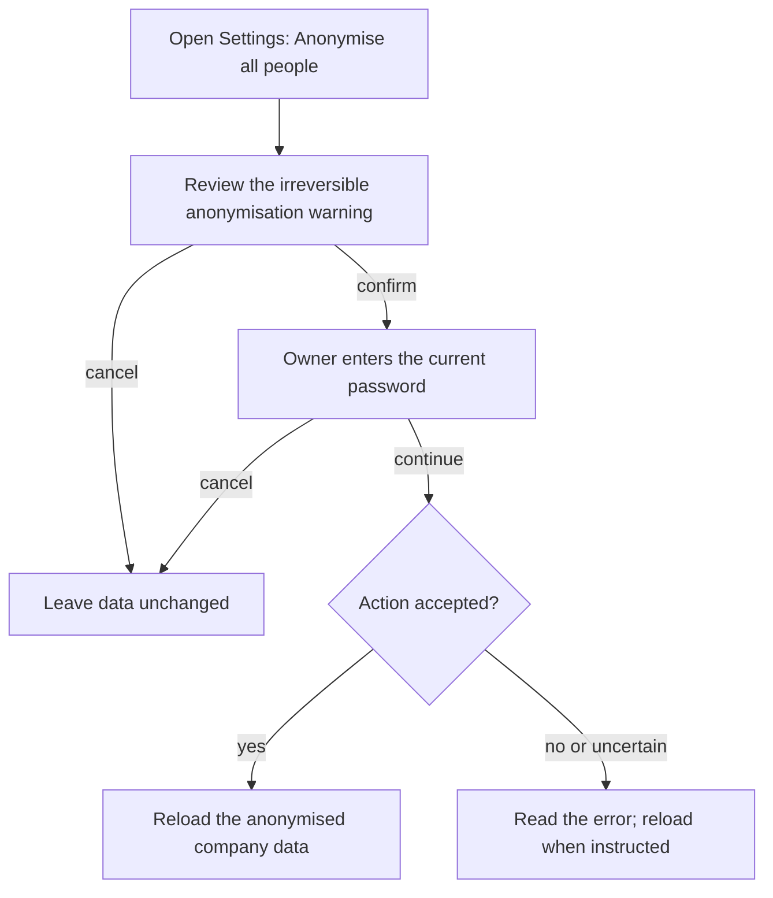
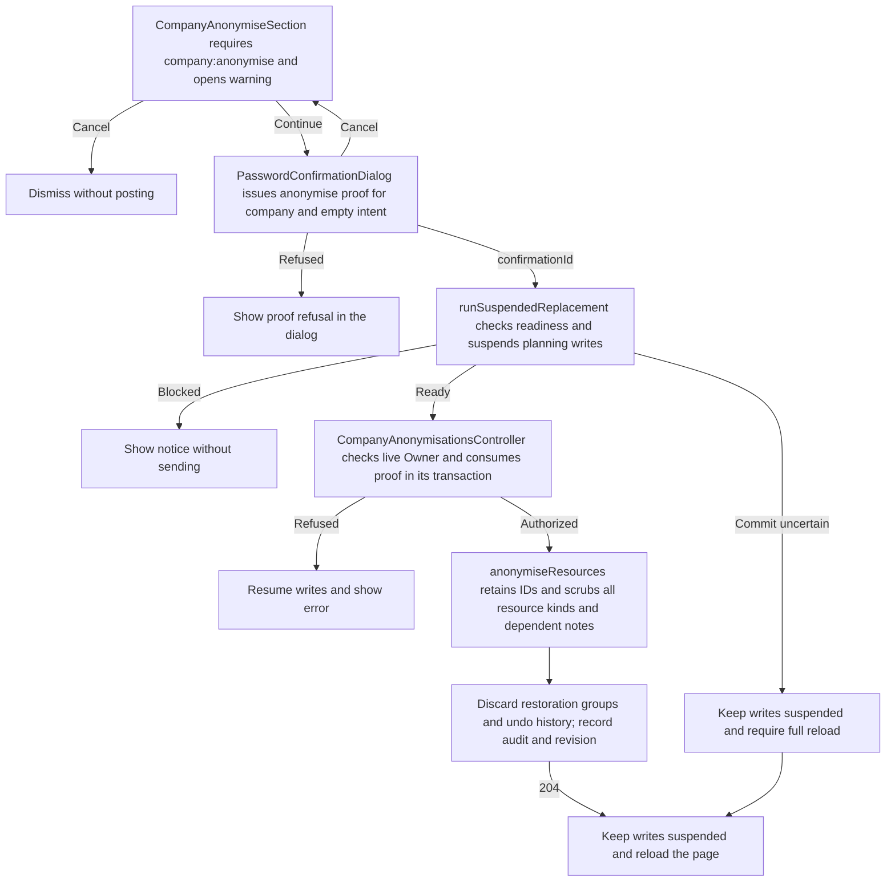

# US-SET-26 — Anonymise all people

As an Owner, I want to anonymise all people so that identifying details and dependent notes are removed company-wide.

**Status:** Current
**Access:** Owner.
**Entry:** Settings → Data and support → Anonymise all people
**Documentation:** [Settings](../../docs-src/using/settings.md)
**Source:** [CompanyAnonymiseSection.tsx](../../apps/frontend/src/components/settings/CompanyAnonymiseSection.tsx), [PasswordConfirmationDialog.tsx](../../apps/frontend/src/auth/PasswordConfirmationDialog.tsx)

## Acceptance criteria

| Field    | Control        | Required/default/conditions                          |
| -------- | -------------- | ---------------------------------------------------- |
| Password | Password input | Required after confirmation; current Owner password. |

- **Anonymise all people** opens confirmation; **Cancel** leaves data unchanged. Confirming continues to the password dialog on the server.
- **Continue** anonymises identifying resource details and dependent notes. Company, catalogue and membership records remain.

## User flow

## Code flow

See [password proof issuance](../data/US-DAT-08-preview-exact-import.md#code-flow) for the shared authorization callback. Company anonymisation uses an empty intent.

**Code references:** [CompanyAnonymiseSection.tsx](../../apps/frontend/src/components/settings/CompanyAnonymiseSection.tsx#L43) · [CompanyAnonymiseSection.tsx](../../apps/frontend/src/components/settings/CompanyAnonymiseSection.tsx#L89) · [company_anonymisations_controller.ts](../../apps/backend/app/controllers/company_anonymisations_controller.ts#L23) · [anonymise.ts](../../apps/backend/app/services/anonymise.ts#L12) · [transitions.ts](../../packages/shared/src/domain/lifecycle/transitions.ts#L101) · [anonymise.spec.ts](../../apps/backend/tests/functional/anonymise.spec.ts#L229) · [anonymise.spec.ts](../../apps/backend/tests/functional/anonymise.spec.ts#L415) · [suspendedReplacement.ts](../../apps/frontend/src/store/suspendedReplacement.ts#L101)
