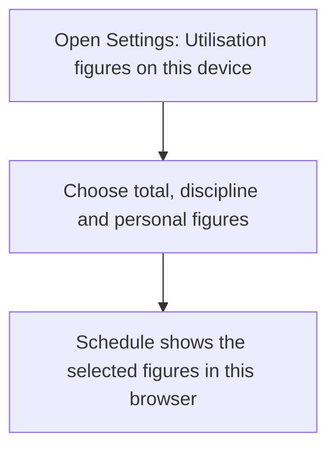
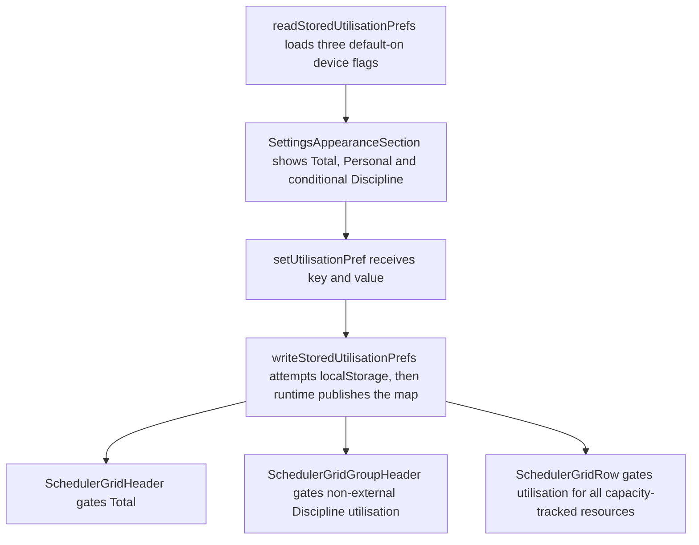

# US-SET-27 — Choose which utilisation figures to show

As a company member, I want to choose which utilisation figures appear on my schedule so that I can focus on the level of detail I need.

**Status:** Current
**Access:** Viewer, Editor, Admin and Owner; this device only.
**Entry:** Settings → My display → Utilisation figures on this device.
**Documentation:** [Settings](../../docs-src/using/settings.md)
**Source:** [SettingsAppearanceSection.tsx](../../apps/frontend/src/components/settings/SettingsAppearanceSection.tsx), [displayPrefs.ts](../../apps/frontend/src/lib/displayPrefs.ts)

## Acceptance criteria

| Field                       | Control | Required/default/conditions                                     |
| --------------------------- | ------- | --------------------------------------------------------------- |
| Show Total Utilisation      | Switch  | On by default.                                                  |
| Show Discipline Utilisation | Switch  | On by default; shown only when company disciplines are enabled. |
| Show Personal Utilisation   | Switch  | On by default.                                                  |

## User flow

## Code flow

**Code references:** [displayPrefs.ts:107](../../apps/frontend/src/lib/displayPrefs.ts#L107) · [SettingsAppearanceSection.tsx:41](../../apps/frontend/src/components/settings/SettingsAppearanceSection.tsx#L41) · [runtimeSlice.ts:118](../../apps/frontend/src/store/slices/runtimeSlice.ts#L118) · [SchedulerGridHeader.tsx:48](../../apps/frontend/src/components/scheduler/SchedulerGridHeader.tsx#L48) · [SchedulerGridGroupHeader.tsx:24](../../apps/frontend/src/components/scheduler/SchedulerGridGroupHeader.tsx#L24) · [SchedulerGridRow.tsx:132](../../apps/frontend/src/components/scheduler/SchedulerGridRow.tsx#L132)
