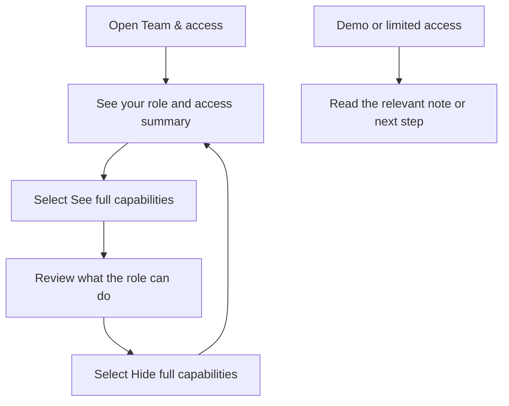
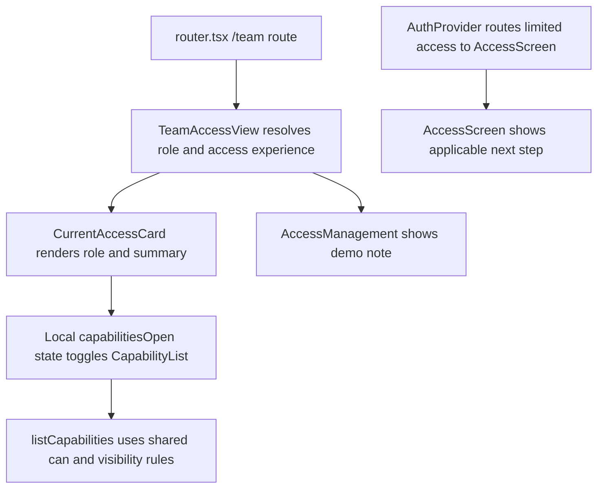

# US-TEAM-01 — Check company access

As a company member, I want to see my role and its capabilities so that I understand what I can do.

**Status:** Current
**Access:** Owner, Admin, Editor, Viewer
**Entry:** Team & access → Your access
**Documentation:** [Team & access](../../docs-src/using/team-access.md)
**Source:** [TeamAccessView.tsx](../../apps/frontend/src/components/team/TeamAccessView.tsx)

## Acceptance criteria

- Team & access shows the signed-in member's role and a **See full capabilities** control that expands or collapses the capability list.
- Demo users see the demo access note; people without company access see the applicable limited-access step.

## User flow

## Code flow

**Code references:** [router.tsx](../../apps/frontend/src/router.tsx), [TeamAccessView.tsx](../../apps/frontend/src/components/team/TeamAccessView.tsx), [AuthProvider.tsx](../../apps/frontend/src/auth/AuthProvider.tsx), [AccessScreens.tsx](../../apps/frontend/src/auth/AccessScreens.tsx), [access.ts](../../packages/shared/src/domain/access.ts)
