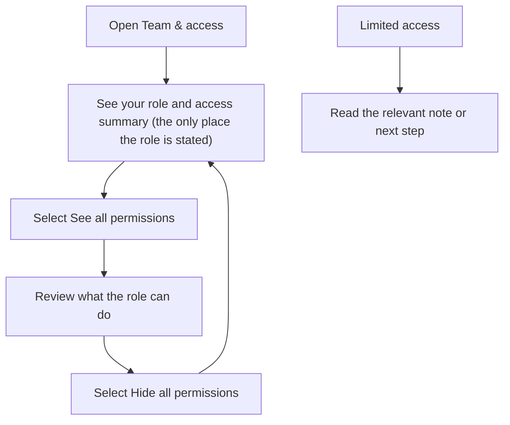
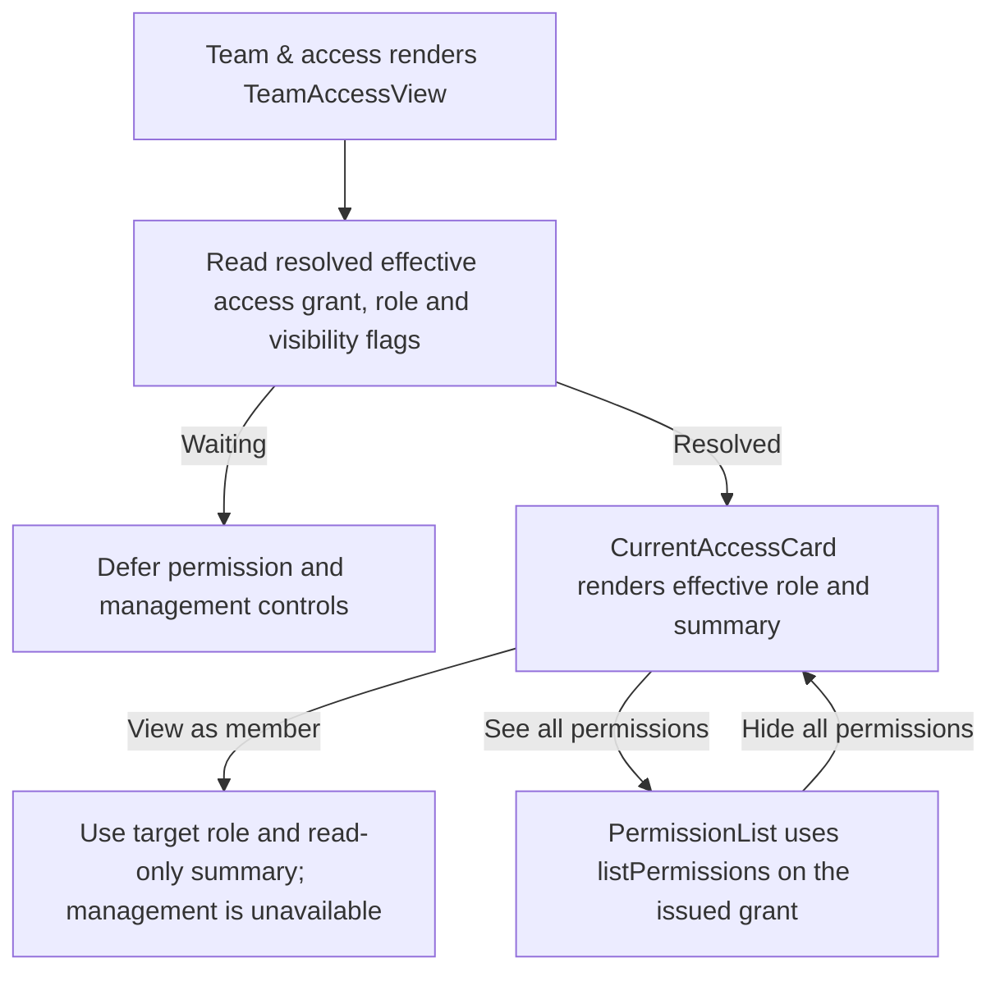

# US-TEAM-01 — Check company access

As a company member, I want to see my role and its permissions so that I understand what I can do.

**Status:** Current
**Access:** Owner, Admin, Editor, Viewer
**Entry:** Team & access → Your access
**Documentation:** [Team & access](../../docs-src/using/team-access.md)
**Source:** [TeamAccessView.tsx](../../apps/frontend/src/components/team/TeamAccessView.tsx)

## Acceptance criteria

- **Your access** shows the member’s role and a summary of what it allows. It is the only place the app states the signed-in person’s role; the left menu does not show a company name or role label. **See all permissions** expands a list marking each capability Allowed or Not allowed (view the schedule, edit scheduling data, manage members and invites, see time-off notes, see private real names, transfer ownership); **Hide all permissions** collapses it.
- Owners and Admins also see member management; other roles see that an Owner or Admin manages invitations and membership changes.
- A signed-in person without company access sees the applicable limited-access screen instead of Team & access.

## User flow

## Code flow

**Code references:** [TeamAccessView.tsx](../../apps/frontend/src/components/team/TeamAccessView.tsx#L42) · [TeamAccessView.tsx](../../apps/frontend/src/components/team/TeamAccessView.tsx#L81) · [TeamAccessView.tsx](../../apps/frontend/src/components/team/TeamAccessView.tsx#L154) · [masquerade_mode_service.ts](../../apps/backend/app/services/auth/masquerade_mode_service.ts#L122)
