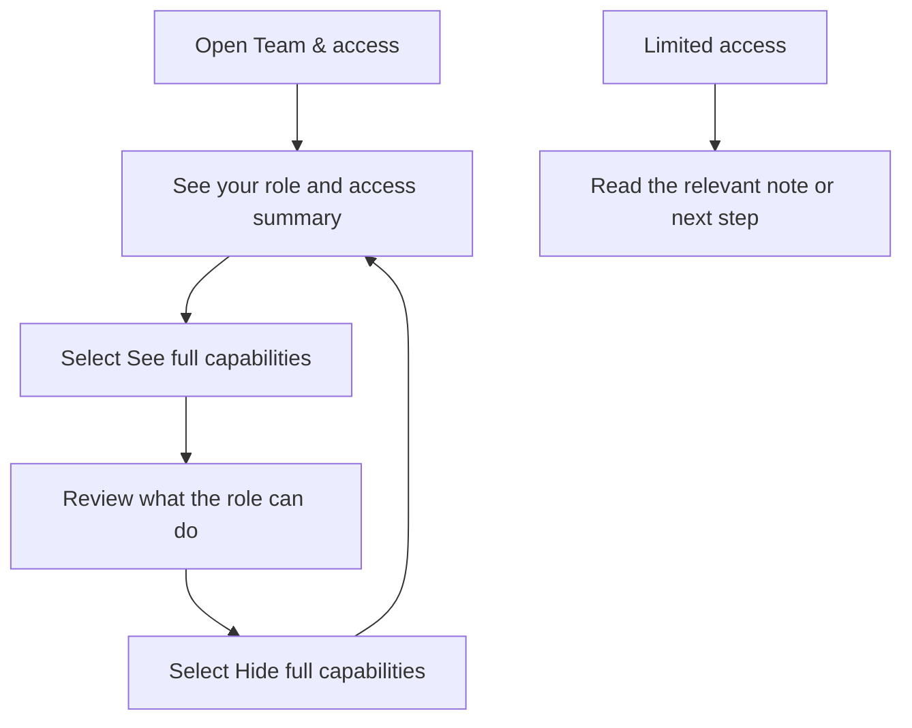
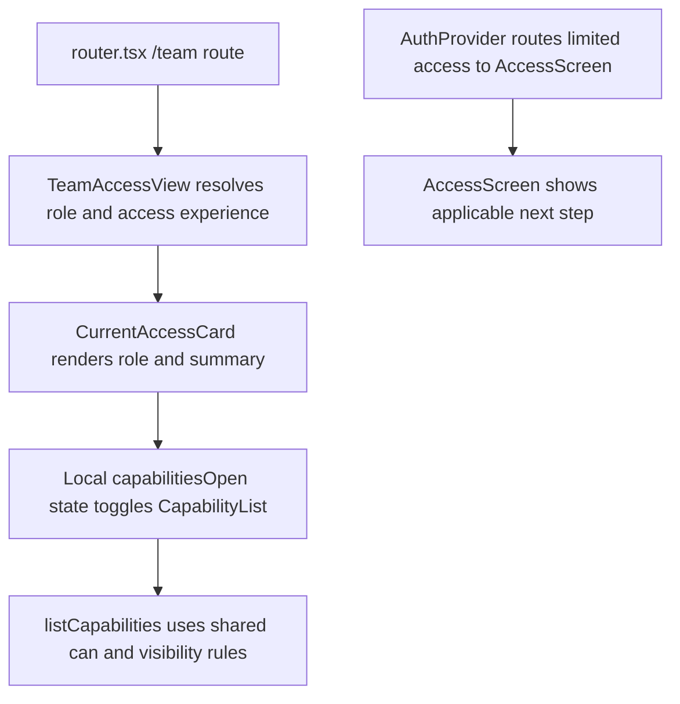

# US-TEAM-01 — Check company access

As a company member, I want to see my role and its capabilities so that I understand what I can do.

**Status:** Current
**Access:** Owner, Admin, Editor, Viewer
**Entry:** Team & access → Your access
**Documentation:** [Team & access](../../docs-src/using/team-access.md)
**Source:** [TeamAccessView.tsx](../../apps/frontend/src/components/team/TeamAccessView.tsx)

## Acceptance criteria

- **Your access** shows the member’s role and a summary of what it allows. **See full capabilities** expands a list marking each capability Allowed or Not allowed (view the schedule, edit scheduling data, manage members and invites, see time-off notes, see private real names, transfer ownership); **Hide full capabilities** collapses it.
- Owners and Admins also see member management; other roles see that an Owner or Admin manages invitations and membership changes.
- A signed-in person without company access sees the applicable limited-access screen instead of Team & access.

## User flow

## Code flow

**Code references:** [router.tsx](../../apps/frontend/src/router.tsx), [TeamAccessView.tsx](../../apps/frontend/src/components/team/TeamAccessView.tsx), [AuthProvider.tsx](../../apps/frontend/src/auth/AuthProvider.tsx), [AccessScreens.tsx](../../apps/frontend/src/auth/AccessScreens.tsx), [access.ts](../../packages/shared/src/domain/access.ts)
