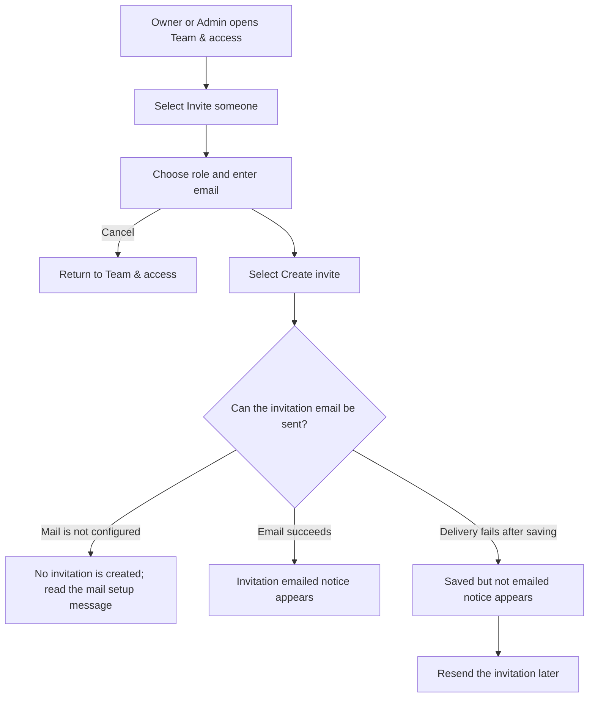
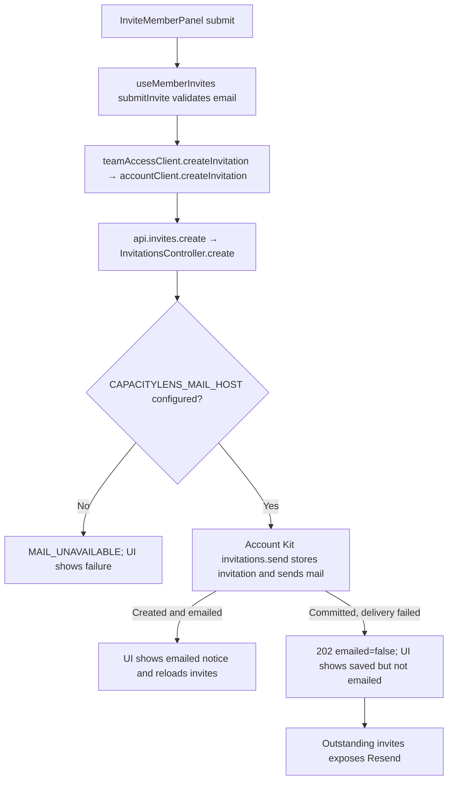

# US-TEAM-02 — Invite a teammate

As an Owner or Admin, I want to email a teammate an invitation with a role so that they can request company access.

**Status:** Current
**Access:** Owner, Admin
**Entry:** Team & access → Invite someone
**Documentation:** [Invite teammates](../../docs-src/admin/invite-teammates.md)
**Source:** [InviteMemberPanel.tsx](../../apps/frontend/src/components/team/InviteMemberPanel.tsx)

## Acceptance criteria

| Field | Control     | Required/default/conditions                                                     |
| ----- | ----------- | ------------------------------------------------------------------------------- |
| Role  | Select      | Required; defaults to Editor; Admin, Editor or Viewer are available, not Owner. |
| Email | Email input | Required; invitee's address.                                                    |

- **Create invite** emails the invitation; the app does not display the invitation link. Missing mail configuration prevents creation. If delivery fails after the invitation was saved, the page explains that it was saved but not emailed and it can be resent.

## User flow

## Code flow

**Code references:** [InviteMemberPanel.tsx](../../apps/frontend/src/components/team/InviteMemberPanel.tsx), [useMemberInvites.ts](../../apps/frontend/src/components/team/useMemberInvites.ts), [teamAccessClient.ts](../../apps/frontend/src/account/teamAccessClient.ts), [accountClient.ts](../../apps/frontend/src/account/accountClient.ts), [admission_routes.ts](../../apps/backend/start/admission_routes.ts), [invitations_controller.ts](../../apps/backend/app/controllers/invitations_controller.ts)
