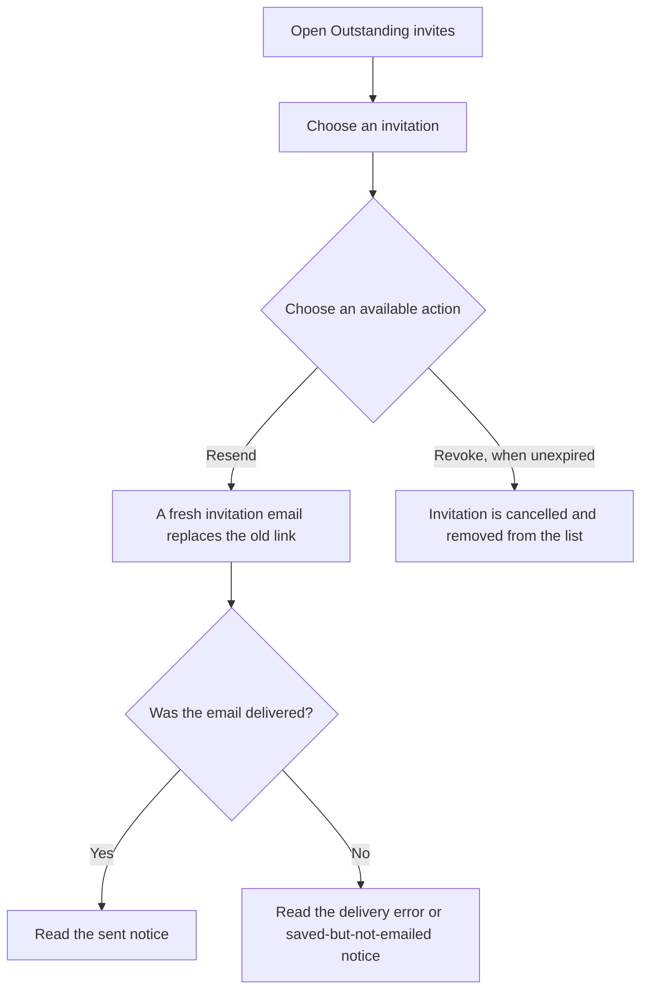
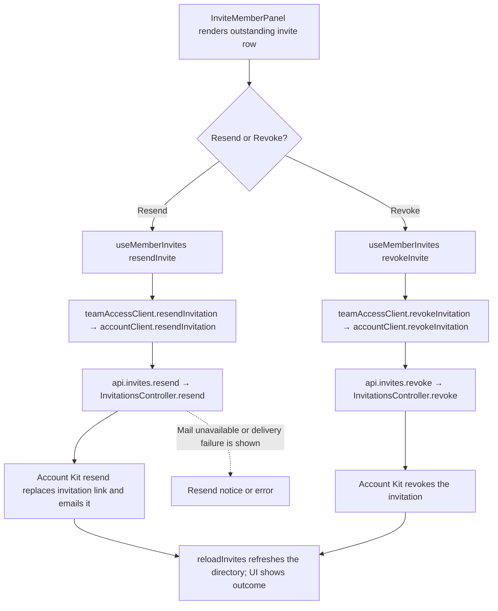

# US-TEAM-03 — Resend or revoke an invitation

As an Owner or Admin, I want to resend or revoke an outstanding invitation so that I can keep unaccepted access offers current.

**Status:** Current
**Access:** Owner, Admin
**Entry:** Team & access → Outstanding invites
**Documentation:** [Invite teammates](../../docs-src/admin/invite-teammates.md#revoke-an-invitation)
**Source:** [InviteMemberPanel.tsx](../../apps/frontend/src/components/team/InviteMemberPanel.tsx)

## Acceptance criteria

- Each invitation shows its email, offered role and expiry date or expired status.
- **Resend** emails a fresh link that replaces the previous one; it is refused when email delivery is not configured.
- **Revoke** cancels an unexpired invitation; expired invitations do not show the Revoke control.

## User flow

## Code flow

**Code references:** [InviteMemberPanel.tsx](../../apps/frontend/src/components/team/InviteMemberPanel.tsx), [useMemberInvites.ts](../../apps/frontend/src/components/team/useMemberInvites.ts), [teamAccessClient.ts](../../apps/frontend/src/account/teamAccessClient.ts), [accountClient.ts](../../apps/frontend/src/account/accountClient.ts), [admission_routes.ts](../../apps/backend/start/admission_routes.ts), [invitations_controller.ts](../../apps/backend/app/controllers/invitations_controller.ts)
