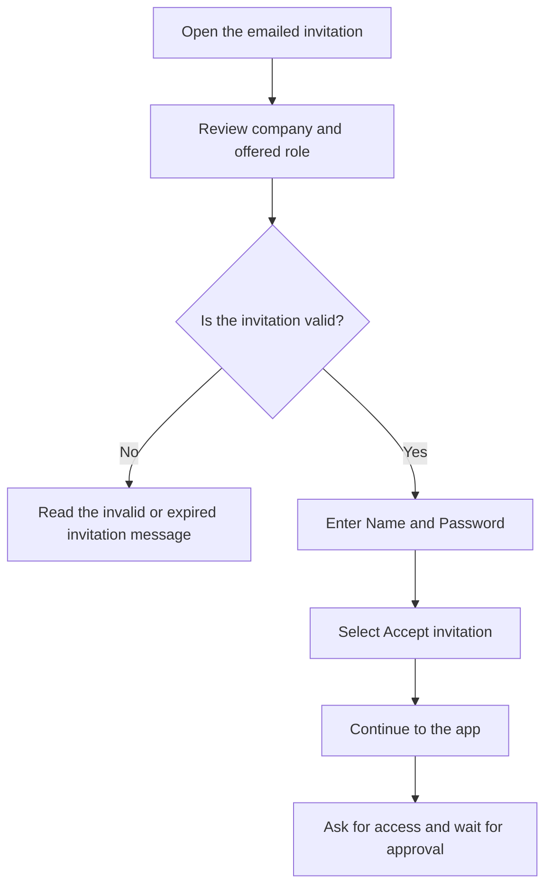
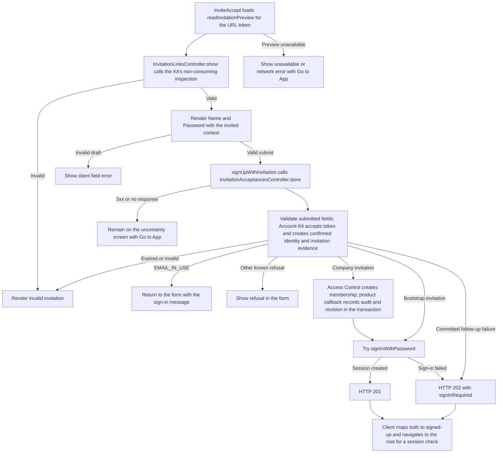

# US-TEAM-04 — Accept an emailed invitation

As an invited person, I want to accept my email invitation so that I can request access to the company.

**Status:** Current
**Access:** Person with a valid invitation
**Entry:** Invitation email → Accept invitation
**Documentation:** [Join your team](../../docs-src/using/join-your-team.md#accept-an-invitation)
**Source:** [InviteAccept.tsx](../../apps/frontend/src/components/invitations/InviteAccept.tsx)

## Acceptance criteria

- Use the **Name** and **Password** fields in [Create my account from an invitation](../account/US-ACCOUNT-06-sign-up.md).

- The page shows the invited company and role, then **Accept invitation** creates the invited sign-in and membership. The person must still ask for access and receive approval before seeing company data.

## User flow

## Code flow

**Code references:** [InviteAccept.tsx](../../apps/frontend/src/components/invitations/InviteAccept.tsx#L55) · [InviteAccept.tsx](../../apps/frontend/src/components/invitations/InviteAccept.tsx#L97) · [invitation_links_controller.ts](../../apps/backend/app/controllers/invitation_links_controller.ts#L11) · [invitation_acceptances_controller.ts](../../apps/backend/app/controllers/invitation_acceptances_controller.ts#L22) · [invitationSignUpApi.ts](../../apps/frontend/src/account/invitationSignUpApi.ts#L64) · [account_kit.ts](../../apps/backend/config/account_kit.ts#L72) · [membership_effects.ts](../../apps/backend/app/services/account_kit/membership_effects.ts#L8) · [invitations.spec.ts](../../apps/backend/tests/functional/auth/invitations.spec.ts#L80)
