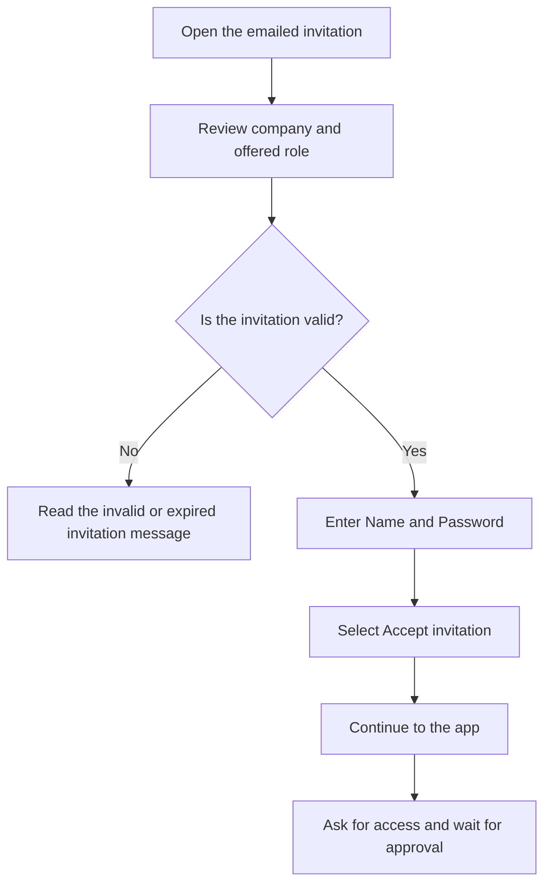
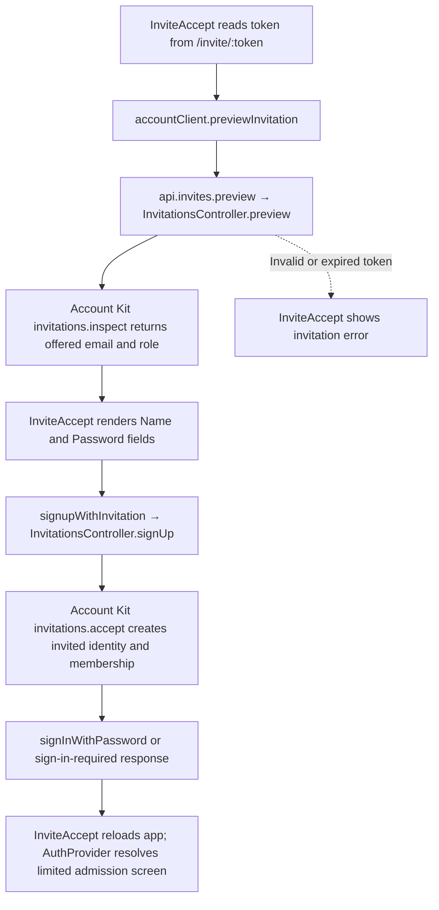

# US-TEAM-04 — Accept an emailed invitation

As an invited person, I want to accept my email invitation so that I can request access to the company.

**Status:** Current
**Access:** Person with a valid invitation
**Entry:** Invitation email → Accept invitation
**Documentation:** [Join your team](../../docs-src/using/join-your-team.md#accept-an-invitation)
**Source:** [InviteAccept.tsx](../../apps/frontend/src/components/invites/InviteAccept.tsx)

## Acceptance criteria

- Use the **Name** and **Password** fields in [Create my account from an invitation](../account/US-ACCOUNT-06-register.md).

- The page shows the invited company and role, then **Accept invitation** creates the invited sign-in and membership. The person must still ask for access and receive approval before seeing company data.

## User flow

## Code flow

**Code references:** [InviteAccept.tsx](../../apps/frontend/src/components/invites/InviteAccept.tsx), [accountClient.ts](../../apps/frontend/src/account/accountClient.ts), [admission_routes.ts](../../apps/backend/start/admission_routes.ts), [invitations_controller.ts](../../apps/backend/app/controllers/invitations_controller.ts), [AuthProvider.tsx](../../apps/frontend/src/auth/AuthProvider.tsx), [AccessScreens.tsx](../../apps/frontend/src/auth/AccessScreens.tsx)
