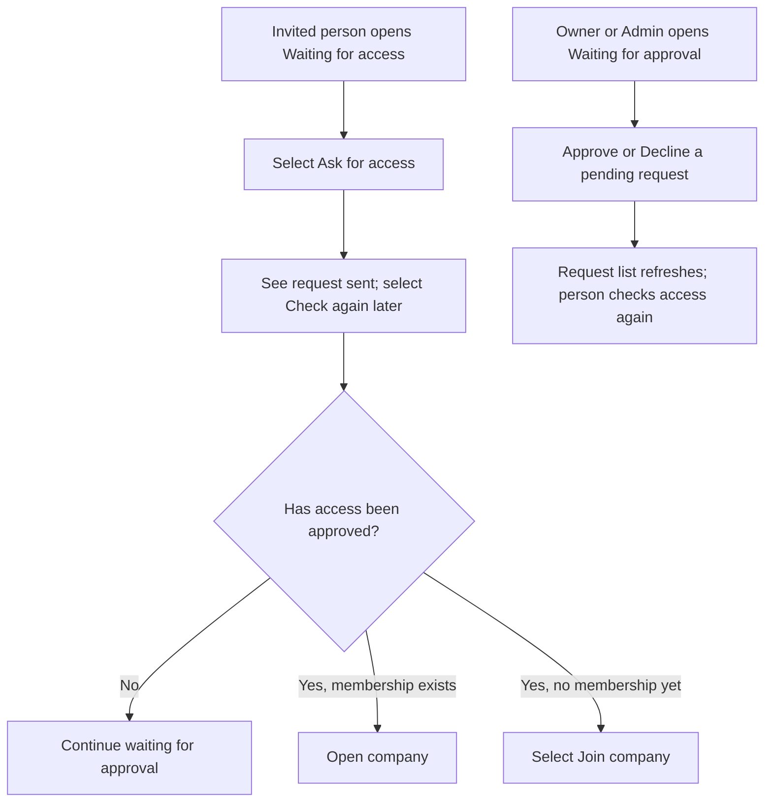
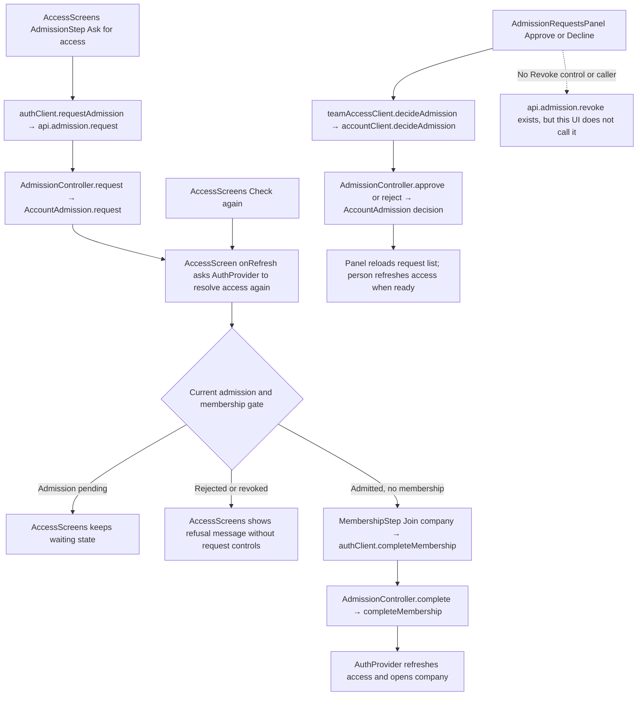

# US-TEAM-05 — Request and decide company access

As an invited person, I want to request company access and check the decision so that I know when I can join.

**Status:** Current
**Access:** Invited person; Owner or Admin decides requests
**Entry:** Waiting for access screen; Team & access → Waiting for approval
**Documentation:** [Join your team](../../docs-src/using/join-your-team.md); [Invite teammates](../../docs-src/admin/invite-teammates.md#approve-new-people)
**Source:** [AccessScreens.tsx](../../apps/frontend/src/auth/AccessScreens.tsx); [AdmissionRequestsPanel.tsx](../../apps/frontend/src/components/team/AdmissionRequestsPanel.tsx)

## Acceptance criteria

- A person who can request access sees **Ask for access**; after requesting, the screen says the request was sent and offers **Check again**.
- When approval is granted, **Check again** refreshes access and the approved person can select **Join company** if they do not yet have a membership.
- Owner and Admin see waiting requests with each person's email and invited role when available. They can **Approve** a request or **Decline** a pending request; declined or revoked requests stay listed, and **Approve** remains available.
- A declined or revoked person sees the access message without request or refresh controls. A person without an invitation or with a disallowed email domain sees the corresponding instruction.

## User flow

## Code flow

**Code references:** [AccessScreens.tsx](../../apps/frontend/src/auth/AccessScreens.tsx), [authClient.ts](../../apps/frontend/src/auth/authClient.ts), [AdmissionRequestsPanel.tsx](../../apps/frontend/src/components/team/AdmissionRequestsPanel.tsx), [teamAccessClient.ts](../../apps/frontend/src/account/teamAccessClient.ts), [accountClient.ts](../../apps/frontend/src/account/accountClient.ts), [admission_routes.ts](../../apps/backend/start/admission_routes.ts), [admission_controller.ts](../../apps/backend/app/controllers/admission_controller.ts), [admission_membership.ts](../../apps/backend/app/services/membership/admission_membership.ts)
