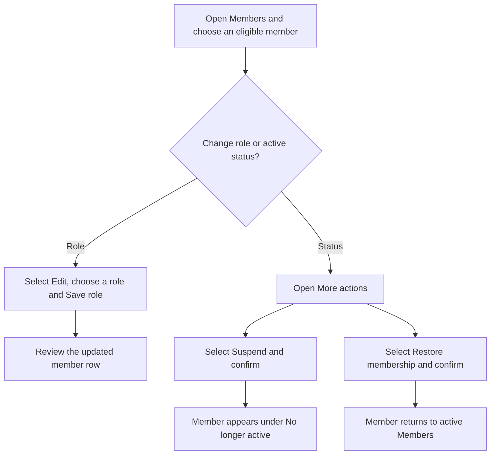
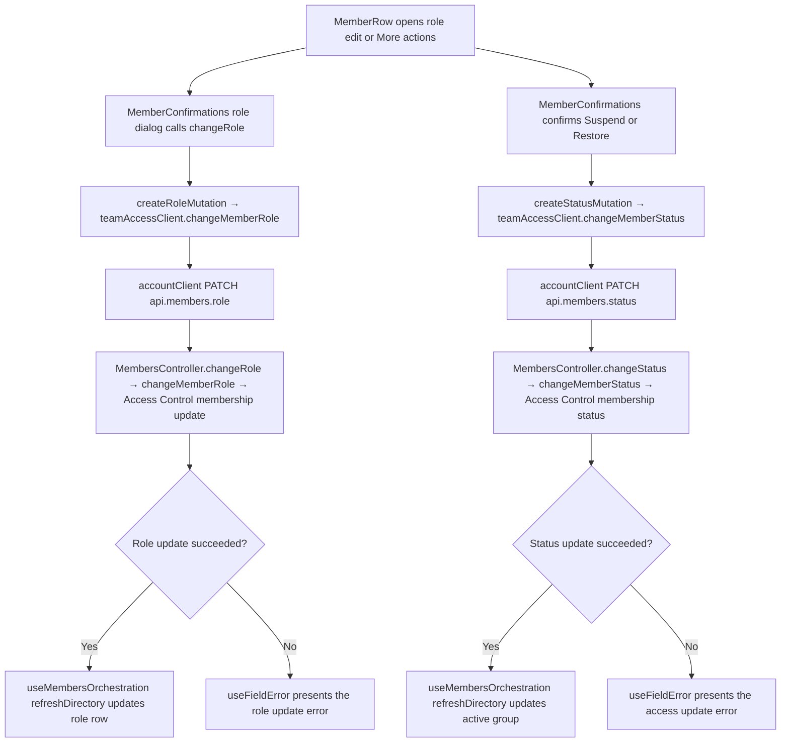

# US-TEAM-06 — Change a member's role or access

As an Owner or Admin, I want to change an eligible member's role or active status so that company access matches their responsibilities.

**Status:** Current
**Access:** Owner or Admin; own membership and the Owner are not manageable
**Entry:** Team & access → Members → member actions
**Documentation:** [Invite teammates](../../docs-src/admin/invite-teammates.md#change-a-members-role-or-schedule-row); [Stop access](../../docs-src/admin/invite-teammates.md#stop-access)
**Source:** [MemberConfirmations.tsx](../../apps/frontend/src/components/team/MemberConfirmations.tsx); [MemberRow.tsx](../../apps/frontend/src/components/team/MemberRow.tsx)

## Acceptance criteria

| Field       | Control | Required/default/conditions                                              |
| ----------- | ------- | ------------------------------------------------------------------------ |
| Member role | Select  | Required; starts with the member's current role. Owner is not an option. |

- **Edit {member}** opens **Change member role?** with the Member role select and a summary of the selected role; **Save role** applies it and **Cancel** keeps the current role.
- **Suspend** asks for confirmation and explains that access stops while role and history remain. **Restore membership** asks for confirmation and restores the member with the previous role.
- Active members appear in Members; suspended members appear under **No longer active**. Nobody can change their own membership or the Owner through these controls.

## User flow

## Code flow

**Code references:** [MemberRow.tsx](../../apps/frontend/src/components/team/MemberRow.tsx), [MemberConfirmations.tsx](../../apps/frontend/src/components/team/MemberConfirmations.tsx), [useMembersOrchestration.ts](../../apps/frontend/src/components/team/useMembersOrchestration.ts), [createMemberMutations.ts](../../apps/frontend/src/components/team/createMemberMutations.ts), [teamAccessClient.ts](../../apps/frontend/src/account/teamAccessClient.ts), [accountClient.ts](../../apps/frontend/src/account/accountClient.ts), [membership_routes.ts](../../apps/backend/start/membership_routes.ts), [members_controller.ts](../../apps/backend/app/controllers/members_controller.ts), [member_mutations.ts](../../apps/backend/app/services/membership/member_mutations.ts)
