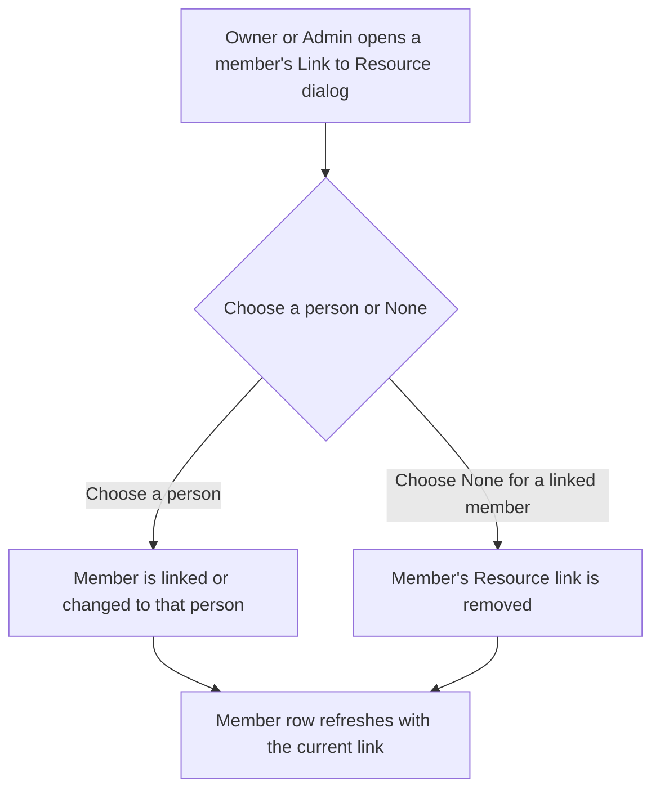
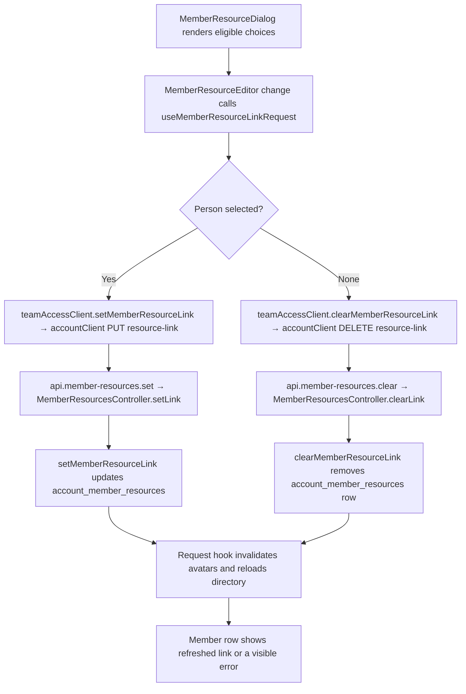

# US-TEAM-07 — Link a member to a Resource

As an Owner or Admin, I want to link a member to a person Resource so that their sign-in is connected to the right schedule row.

**Status:** Current
**Access:** Owner, Admin
**Entry:** Team & access → Members → Link to Resource
**Documentation:** [Link a person to a member](../../docs-src/using/resources.md#link-a-person-to-a-member)
**Source:** [MemberResourceLink.tsx](../../apps/frontend/src/components/team/MemberResourceLink.tsx)

## Acceptance criteria

| Field            | Control | Required/default/conditions                                                                       |
| ---------------- | ------- | ------------------------------------------------------------------------------------------------- |
| Scheduled person | Select  | Optional; shows the current link or None. Choices are active people not linked to another member. |

- Selecting a person links or changes the link immediately. **Remove link to resource** unlinks immediately.
- A retained link to an inactive person is shown and can be removed. Linking a member does not change their access or create schedule data.

## User flow

## Code flow

**Code references:** [MemberResourceLink.tsx](../../apps/frontend/src/components/team/MemberResourceLink.tsx), [useMemberResourceLinkRequest.ts](../../apps/frontend/src/components/team/useMemberResourceLinkRequest.ts), [teamAccessClient.ts](../../apps/frontend/src/account/teamAccessClient.ts), [accountClient.ts](../../apps/frontend/src/account/accountClient.ts), [admission_routes.ts](../../apps/backend/start/admission_routes.ts), [member_resources_controller.ts](../../apps/backend/app/controllers/member_resources_controller.ts), [links.ts](../../apps/backend/app/services/member_resources/links.ts)
