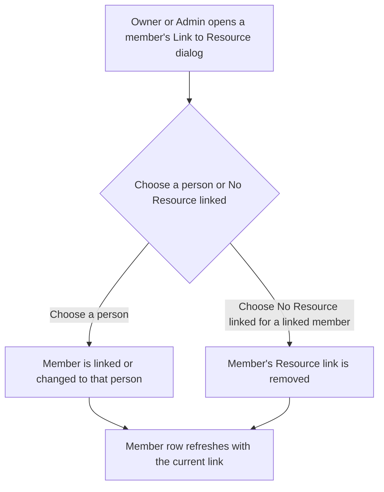
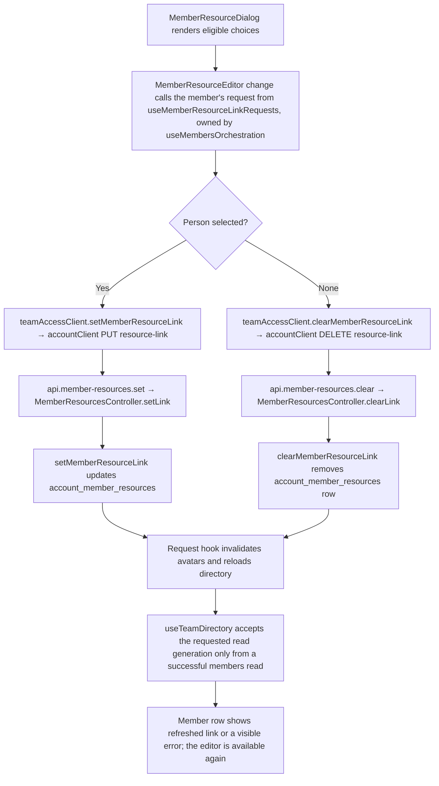

# US-TEAM-07 — Link a member to a Resource

As an Owner or Admin, I want to link a member to a person Resource so that their sign-in is connected to the right schedule row.

**Status:** Current
**Access:** Owner, Admin
**Entry:** Team & access → Members → Link to Resource
**Documentation:** [Link a person to a member](../../docs-src/using/resources.md#link-a-person-to-a-member)
**Source:** [MemberResourceLink.tsx](../../apps/frontend/src/components/team/MemberResourceLink.tsx)

## Acceptance criteria

| Field            | Control | Required/default/conditions                                                                                                 |
| ---------------- | ------- | --------------------------------------------------------------------------------------------------------------------------- |
| Link to Resource | Select  | Optional; shows the current link, otherwise **No Resource linked**. Choices are active people not linked to another member. |

- Selecting a person links or changes the link immediately. **Remove link to resource** unlinks immediately.
- After a change, the selector and **Remove link to resource** stay unavailable until a member list read requested after that change has loaded, so the next change starts from the current link. Closing and reopening the dialog, collapsing the inactive members group or a failed member list read keeps them unavailable. If that read fails, the member list is replaced by its load error and **Retry**, which reloads it.
- An error or uncertain outcome stays in the dialog after closing and reopening it, until the next change. A success message is not shown again when the dialog is reopened.
- A retained link to an archived or deleted person is shown as **{name} (inactive — unlink only)** and can only be removed. Linking a member does not change their access or create schedule data.

## User flow

## Code flow

**Code references:** [MemberResourceLink.tsx](../../apps/frontend/src/components/team/MemberResourceLink.tsx), [useMemberResourceLinkRequest.ts](../../apps/frontend/src/components/team/useMemberResourceLinkRequest.ts), [useTeamDirectory.ts](../../apps/frontend/src/components/team/useTeamDirectory.ts), [teamAccessClient.ts](../../apps/frontend/src/account/teamAccessClient.ts), [accountClient.ts](../../apps/frontend/src/account/accountClient.ts), [admission_routes.ts](../../apps/backend/start/admission_routes.ts), [member_resources_controller.ts](../../apps/backend/app/controllers/member_resources_controller.ts), [links.ts](../../apps/backend/app/services/member_resources/links.ts)
