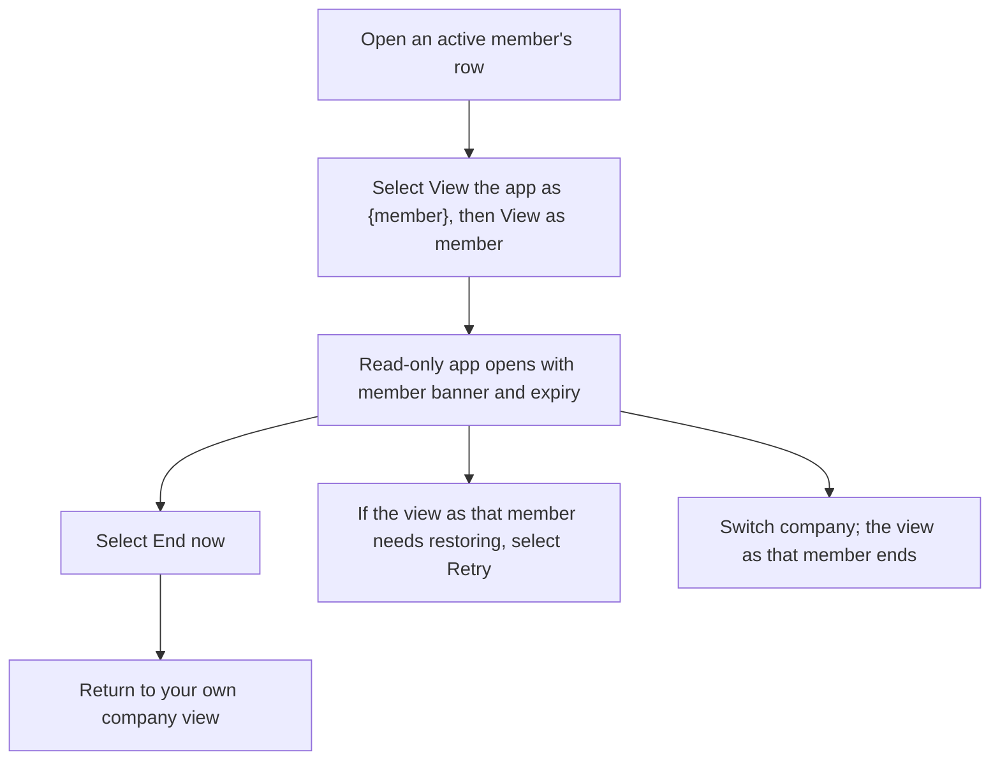
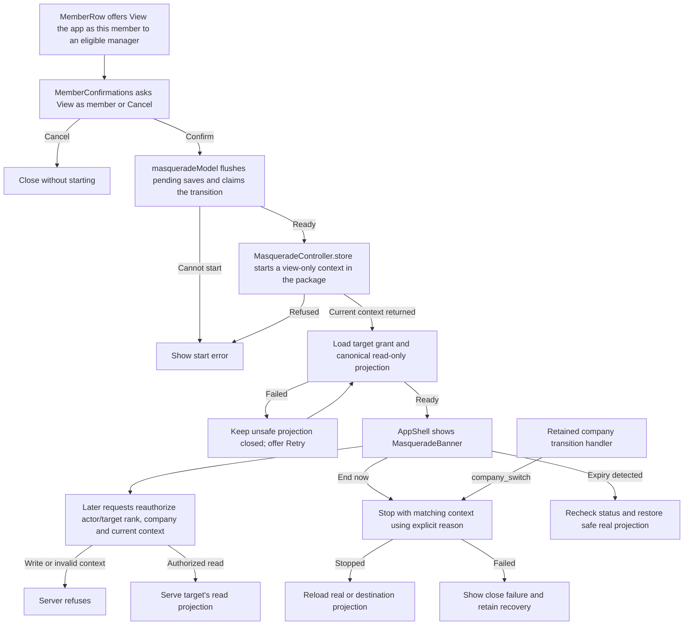

# US-TEAM-08 — View the company as a member

As an Owner or Admin, I want to view the app as another active member ranked at or below me so that I can understand what that member sees.

**Status:** Current
**Access:** Owner, Admin; another active member ranked at or below you is the target
**Entry:** Team & access → Members → View the app as this member
**Documentation:** [Roles and permissions](../../docs-src/getting-started/roles-and-permissions.md)
**Source:** [MemberRow.tsx](../../apps/frontend/src/components/team/MemberRow.tsx); [MasqueradeBanner.tsx](../../apps/frontend/src/components/MasqueradeBanner.tsx)

## Acceptance criteria

- On the row of another active member ranked at or below you, the eye button (**View the app as {member}**) opens **View as this member?**; **View as member** starts the view as that member and **Cancel** closes the dialog.
- A banner reads **Viewing as {name}** with **Ends {time}** and offers **End now**; a **Retry** control appears when the view as that member needs to be restored.
- The view as a member is read-only and expires after 15 minutes. Company navigation ends it; signing out ends it for the current session.
- Other signed-in sessions observe the same view as that member, or its end, on their next request.

## User flow

## Code flow

The current one-company interface offers no company switcher.

**Code references:** [MemberRow.tsx](../../apps/frontend/src/components/team/MemberRow.tsx#L98) · [MasqueradeBanner.tsx](../../apps/frontend/src/components/MasqueradeBanner.tsx#L24) · [masqueradeModel.ts](../../apps/frontend/src/auth/masqueradeModel.ts#L190) · [masqueradeModel.ts](../../apps/frontend/src/auth/masqueradeModel.ts#L311) · [masquerade_controller.ts](../../apps/backend/app/controllers/masquerade_controller.ts#L26) · [masquerade_controller.ts](../../apps/backend/app/controllers/masquerade_controller.ts#L75) · [masquerade.ts](../../apps/backend/app/validators/masquerade.ts#L12) · [masquerade.ts](../../apps/backend/config/masquerade.ts#L46) · [masquerade.ts](../../apps/backend/app/services/auth/masquerade.ts#L124) · [masquerade.spec.ts](../../apps/backend/tests/functional/auth/masquerade.spec.ts#L278)
