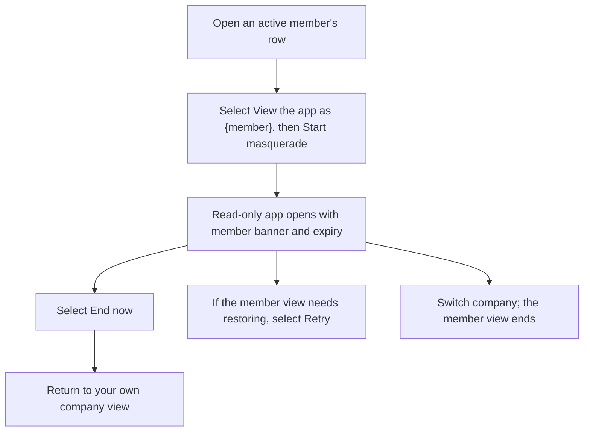
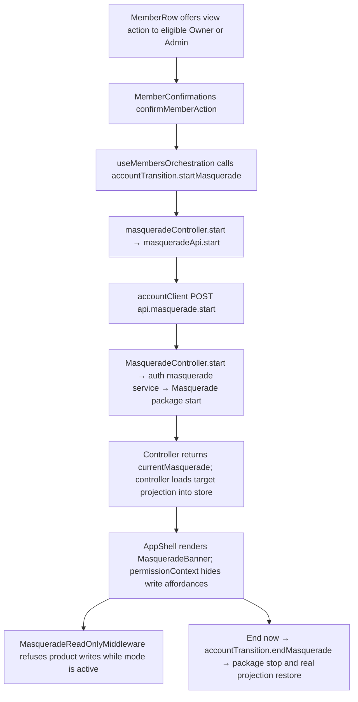

# US-TEAM-08 — View the company as a member

As an Owner or Admin, I want to view the app as another active member so that I can understand what that member sees.

**Status:** Current
**Access:** Owner, Admin; another active member is the target
**Entry:** Team & access → Members → View the app as this member
**Documentation:** [Roles and permissions](../../docs-src/getting-started/roles-and-permissions.md)
**Source:** [MemberRow.tsx](../../apps/frontend/src/components/team/MemberRow.tsx); [MasqueradeBanner.tsx](../../apps/frontend/src/components/MasqueradeBanner.tsx)

## Acceptance criteria

- On another active member’s row, the eye button (**View the app as {member}**) opens **View as this member?**; **Start masquerade** opens the member view and **Cancel** closes the dialog.
- A banner reads **Masquerading as {name}** with **Ends {time}** and offers **End now**; a **Retry** control appears when the member view needs to be restored.
- The member view is read-only and expires after 15 minutes. Company navigation ends it; signing out ends it for the current session.
- Other signed-in sessions observe the same member view, or its end, on their next request.

## User flow

## Code flow

**Code references:** [MemberRow.tsx](../../apps/frontend/src/components/team/MemberRow.tsx), [MemberConfirmations.tsx](../../apps/frontend/src/components/team/MemberConfirmations.tsx), [useMembersOrchestration.ts](../../apps/frontend/src/components/team/useMembersOrchestration.ts), [accountTransition.ts](../../apps/frontend/src/auth/accountTransition.ts), [masqueradeController.ts](../../apps/frontend/src/auth/masqueradeController.ts), [masqueradeApi.ts](../../apps/frontend/src/auth/masqueradeApi.ts), [accountClient.ts](../../apps/frontend/src/account/accountClient.ts), [masquerade_routes.ts](../../apps/backend/start/masquerade_routes.ts), [masquerade_controller.ts](../../apps/backend/app/controllers/masquerade_controller.ts), [masquerade.ts](../../apps/backend/app/services/auth/masquerade.ts), [masquerade_read_only_middleware.ts](../../apps/backend/app/middleware/masquerade_read_only_middleware.ts), [permissionContext.ts](../../apps/frontend/src/auth/permissionContext.ts), [AppShell.tsx](../../apps/frontend/src/components/AppShell.tsx)
