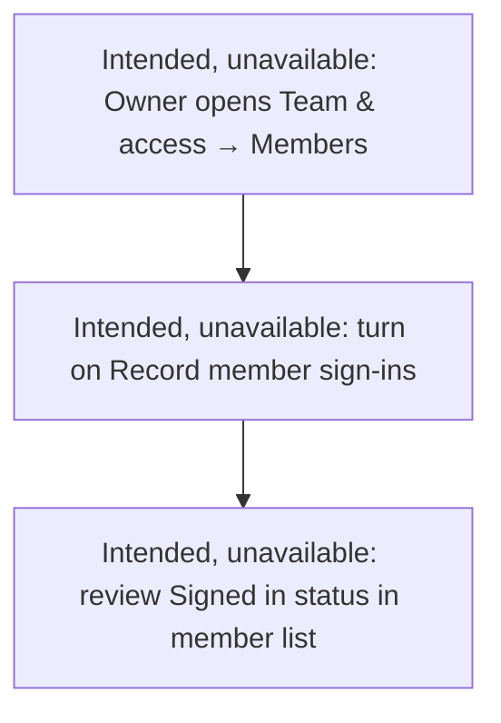
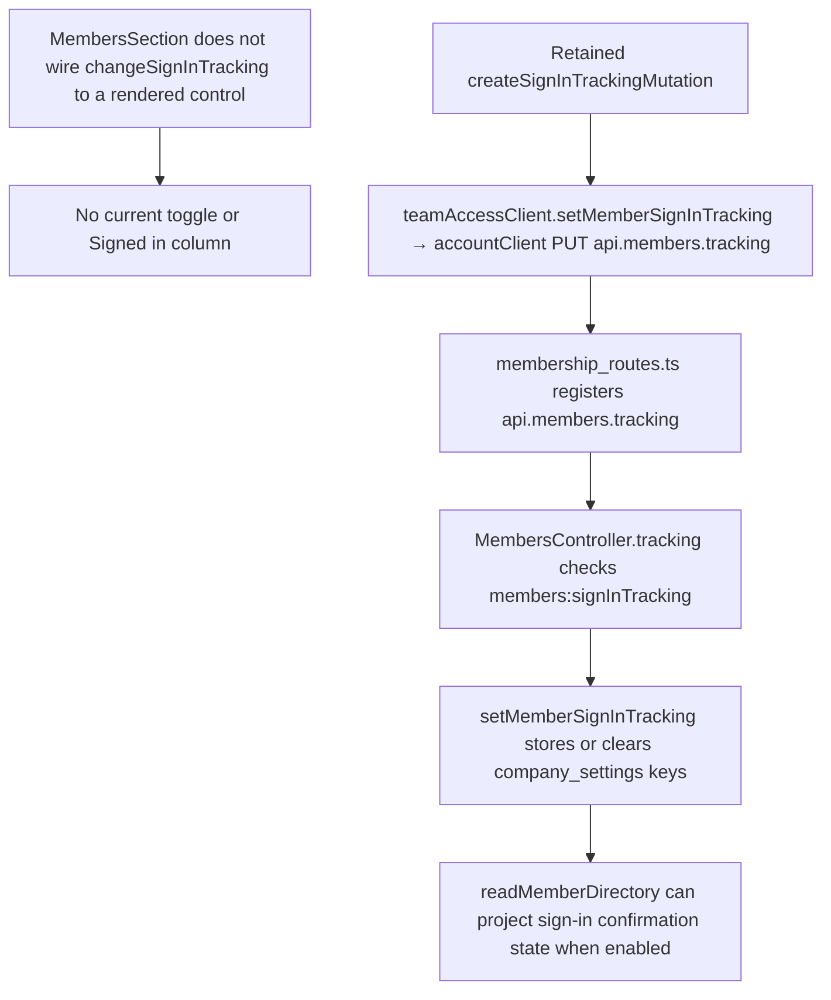

# US-TEAM-11 — Record member sign-ins

As an Owner, I want to enable member sign-in recording so that I can see whether each member has signed in.

**Status:** Hidden — server capability retained; no current product control.
**Access:** Owner; the control is not currently rendered
**Entry:** Team & access → Members (control hidden)
**Documentation:** [Invite teammates](../../docs-src/admin/invite-teammates.md)
**Source:** [MembersSection.tsx](../../apps/frontend/src/components/team/MembersSection.tsx)

## Acceptance criteria

The following retained control is unavailable in the current interface.

| Field                  | Control | Required/default/conditions                 |
| ---------------------- | ------- | ------------------------------------------- |
| Record member sign-ins | Switch  | Owner-only control; not currently rendered. |

- The related **Signed in** column is also hidden.

## User flow

Intended owner flow (unavailable in the current interface):

## Code flow

**Code references:** [MembersSection.tsx](../../apps/frontend/src/components/team/MembersSection.tsx), [useMembersOrchestration.ts](../../apps/frontend/src/components/team/useMembersOrchestration.ts), [createMemberMutations.ts](../../apps/frontend/src/components/team/createMemberMutations.ts), [teamAccessClient.ts](../../apps/frontend/src/account/teamAccessClient.ts), [accountClient.ts](../../apps/frontend/src/account/accountClient.ts), [membership_routes.ts](../../apps/backend/start/membership_routes.ts), [members_controller.ts](../../apps/backend/app/controllers/members_controller.ts), [sign_in_tracking.ts](../../apps/backend/app/services/membership/sign_in_tracking.ts), [member_directory.ts](../../apps/backend/app/services/membership/member_directory.ts), [access.ts](../../packages/shared/src/domain/access.ts)
