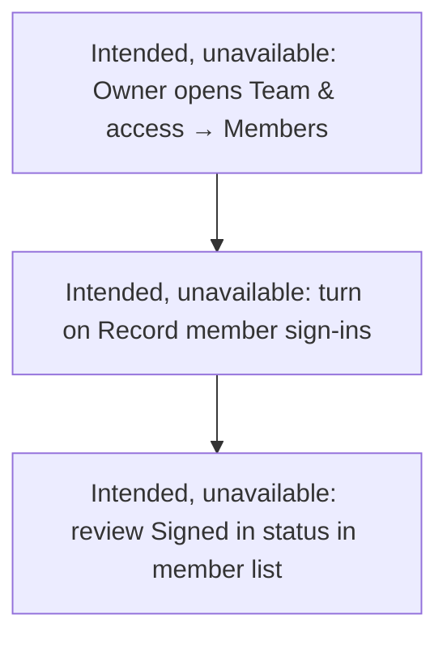
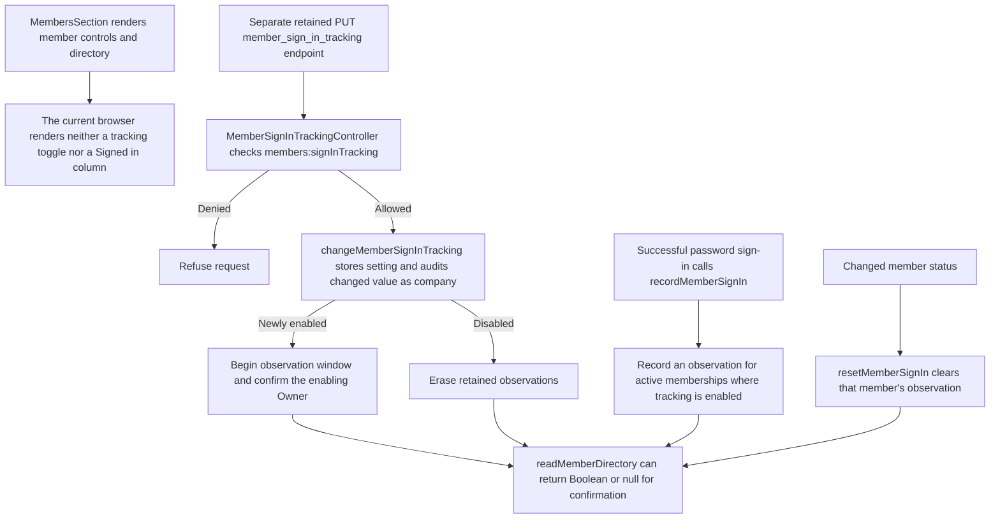

# US-TEAM-11 — Record member sign-ins

As an Owner, I want to enable member sign-in recording so that I can see whether each member has signed in.

**Status:** Hidden — server capability retained; no current product control.
**Access:** Owner; the control is not currently rendered
**Entry:** Team & access → Members (control hidden)
**Documentation:** [Invite teammates](../../docs-src/admin/invite-teammates.md)
**Source:** [MembersSection.tsx](../../apps/frontend/src/components/team/MembersSection.tsx)

## Acceptance criteria

The following retained control is unavailable in the current interface.

| Field                  | Control | Required/default/conditions                 |
| ---------------------- | ------- | ------------------------------------------- |
| Record member sign-ins | Switch  | Owner-only control; not currently rendered. |

- The related **Signed in** column is also hidden.

## User flow

Intended owner flow (unavailable in the current interface):

## Code flow

**Code references:** [MembersSection.tsx](../../apps/frontend/src/components/team/MembersSection.tsx#L143) · [MembersSection.tsx](../../apps/frontend/src/components/team/MembersSection.tsx#L260) · [member_sign_in_tracking_controller.ts](../../apps/backend/app/controllers/member_sign_in_tracking_controller.ts#L10) · [sign_in_tracking.ts](../../apps/backend/app/services/membership/sign_in_tracking.ts#L14) · [sign_in_tracking.ts](../../apps/backend/app/services/membership/sign_in_tracking.ts#L75) · [password_sign_in.ts](../../apps/backend/app/services/auth/password_sign_in.ts#L62) · [member_directory.ts](../../apps/backend/app/services/membership/member_directory.ts#L89) · [member_mutations.ts](../../apps/backend/app/services/membership/member_mutations.ts#L70) · [tracking_lifecycle.spec.ts](../../apps/backend/tests/functional/membership/tracking_lifecycle.spec.ts#L36)
