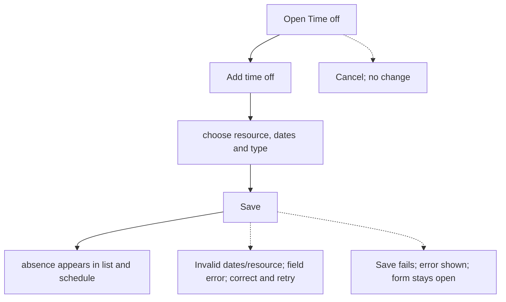
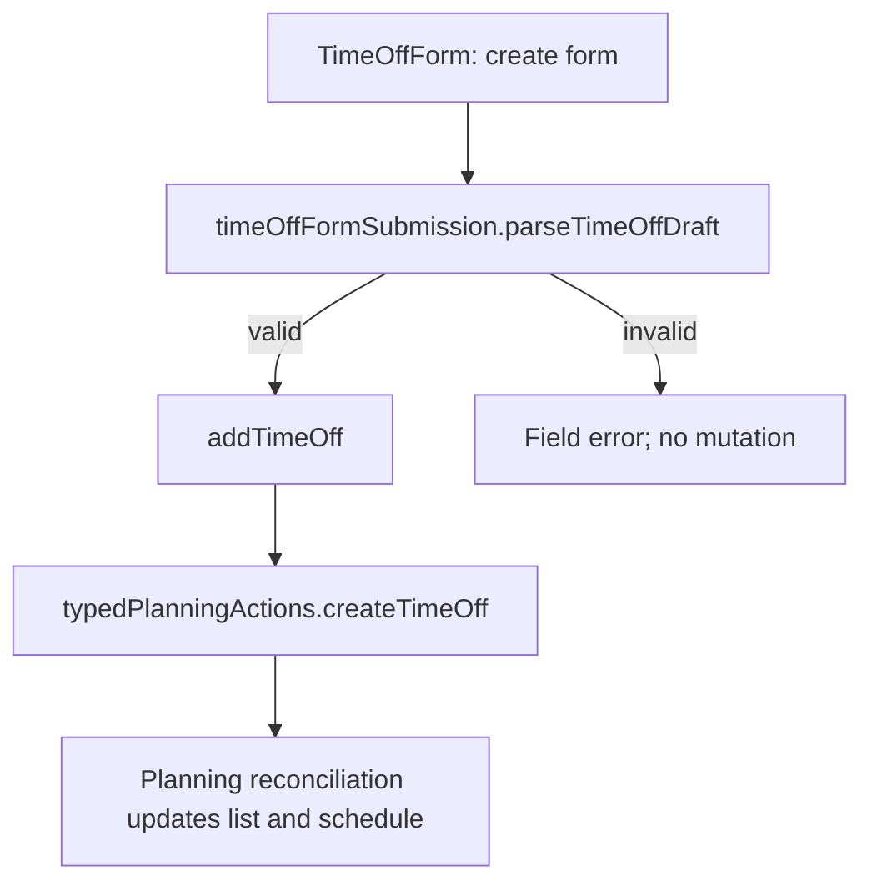

# US-TOF-01 — Book time off for a resource

As an Editor, I want to record personal time off so that the affected dates reduce the resource’s available capacity.

**Status:** Current
**Access:** Editor, Admin or Owner
**Entry:** Time off page
**Documentation:** [time-off.md](../../docs-src/using/time-off.md)
**Source:** [TimeOffForm.tsx](../../apps/frontend/src/components/timeoff/TimeOffForm.tsx), [TimeOffRepeatFields.tsx](../../apps/frontend/src/components/timeoff/TimeOffRepeatFields.tsx)

## Acceptance criteria

| Field        | Control    | Required/default/conditions                                                                                                                                     |
| ------------ | ---------- | --------------------------------------------------------------------------------------------------------------------------------------------------------------- |
| Resource     | Select     | Required; preselected when opened from a Schedule row, otherwise blank; excludes external parties; lists placeholders only when Show placeholders is on         |
| Start        | Date input | Required; defaults to today unless the entry point supplies a date                                                                                              |
| End          | Date input | Required; defaults to today unless the entry point supplies a date; cannot precede Start                                                                        |
| Type         | Select     | Defaults to Holiday; options Holiday, Sick, Unpaid or Other                                                                                                     |
| Repeat       | Select     | Create only; defaults to Doesn’t repeat; Weekly, Every 2 weeks, Every 3 weeks, Every 4 weeks, Monthly on day {day} or Monthly on the last {weekday}             |
| Repeat until | Date input | Required when repeating; suggested and capped at the end of the eleventh calendar month after Start’s month; includes an occurrence starting on the cutoff date |
| Note         | Text input | Optional; shown only to Owners and Admins                                                                                                                       |

- Save creates the time-off entry; Cancel leaves the schedule unchanged.

## User flow

## Code flow

**Code references:**

- [TimeOffForm.tsx](../../apps/frontend/src/components/timeoff/TimeOffForm.tsx)
- [timeOffFormSubmission.ts](../../apps/frontend/src/components/timeoff/timeOffFormSubmission.ts)
- [typedPlanningActions.ts](../../apps/frontend/src/store/typedPlanningActions.ts)
- [planningCacheController.ts](../../apps/frontend/src/data/planning/planningCacheController.ts)
