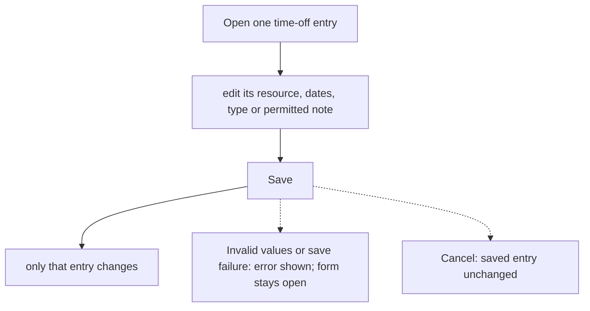
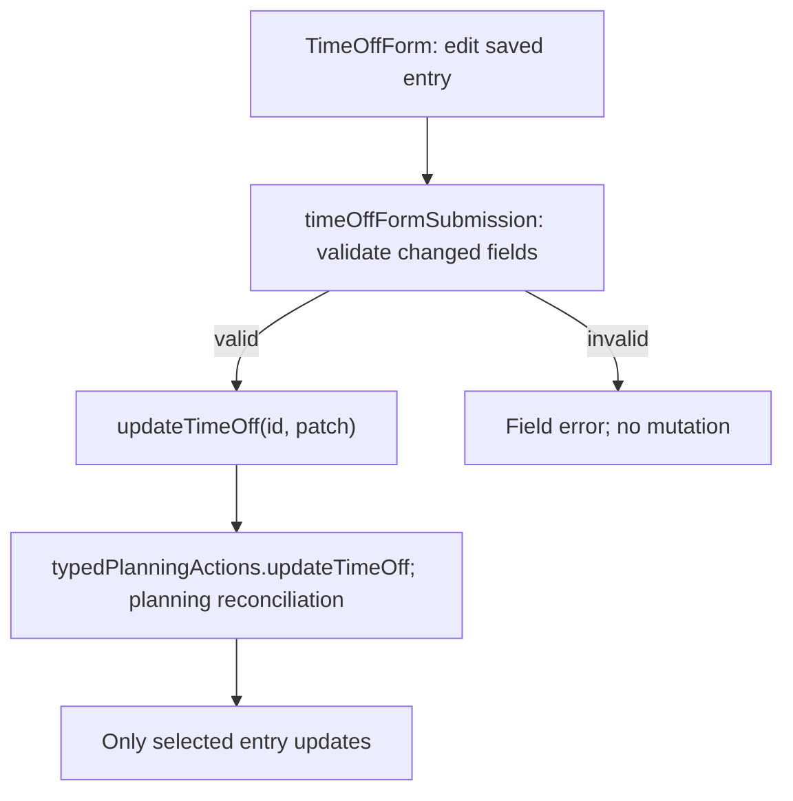

# US-TOF-02 — Edit a time-off entry

As an Editor, I want to edit one time-off entry so that its dates and type stay current without changing other occurrences.

**Status:** Current
**Access:** Editor, Admin or Owner
**Entry:** Time off page
**Documentation:** [time-off.md](../../docs-src/using/time-off.md)
**Source:** [TimeOffForm.tsx](../../apps/frontend/src/components/timeoff/TimeOffForm.tsx), [TimeOffRepeatFields.tsx](../../apps/frontend/src/components/timeoff/TimeOffRepeatFields.tsx)

## Acceptance criteria

| Field    | Control    | Required/default/conditions                                            |
| -------- | ---------- | ---------------------------------------------------------------------- |
| Resource | Select     | Required; prefilled with the saved resource; excludes external parties |
| Start    | Date input | Required; prefilled with the saved start date                          |
| End      | Date input | Required; prefilled with the saved end date; cannot precede Start      |
| Type     | Select     | Prefilled with the saved type; options Holiday, Sick, Unpaid or Other  |
| Note     | Text input | Optional; prefilled; shown only to Owners and Admins                   |

- Save updates this entry only; repeating occurrences remain independent.

## User flow

## Code flow

**Code references:**

- [TimeOffForm.tsx](../../apps/frontend/src/components/timeoff/TimeOffForm.tsx)
- [timeOffFormSubmission.ts](../../apps/frontend/src/components/timeoff/timeOffFormSubmission.ts)
- [typedPlanningActions.ts](../../apps/frontend/src/store/typedPlanningActions.ts)
- [planningCacheController.ts](../../apps/frontend/src/data/planning/planningCacheController.ts)
