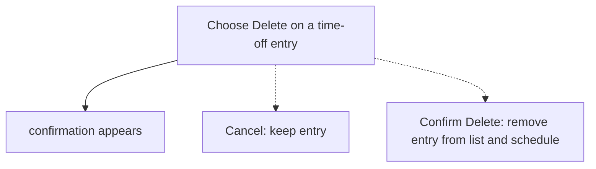
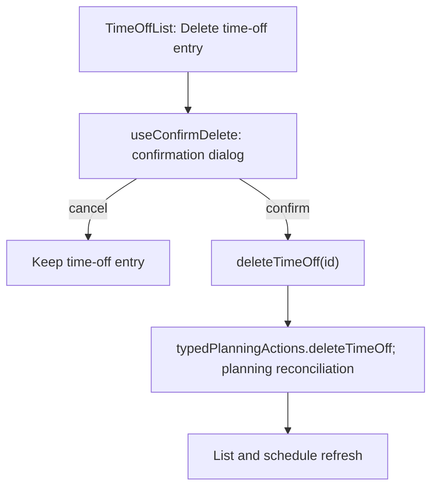

# US-TOF-03 — Delete a time-off entry (confirmed)

As an Editor, I want to confirm before deleting time off so that an accidental removal can be cancelled.

**Status:** Current

**Access:** Editor, Admin or Owner

**Entry:** Time off page

**Documentation:** [time-off.md](../../docs-src/using/time-off.md)

**Source:** [TimeOffForm.tsx](../../apps/frontend/src/components/timeoff/TimeOffForm.tsx)

## Acceptance criteria

- **Delete {name} time off from {start} to {end}** opens **Delete time off?** (“Remove this time-off entry?”) with **Delete** and **Cancel**; Cancel preserves the entry.
- Confirming Delete removes the entry from the list and Schedule.

## User flow

## Code flow

**Code references:**

- [TimeOffList.tsx](../../apps/frontend/src/components/timeoff/TimeOffList.tsx)
- [useConfirmDelete.ts](../../apps/frontend/src/hooks/useConfirmDelete.ts)
- [typedPlanningActions.ts](../../apps/frontend/src/store/typedPlanningActions.ts)
- [planningCacheController.ts](../../apps/frontend/src/data/planning/planningCacheController.ts)
