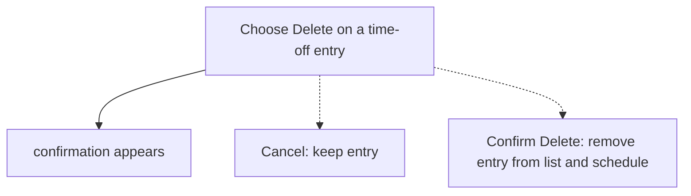
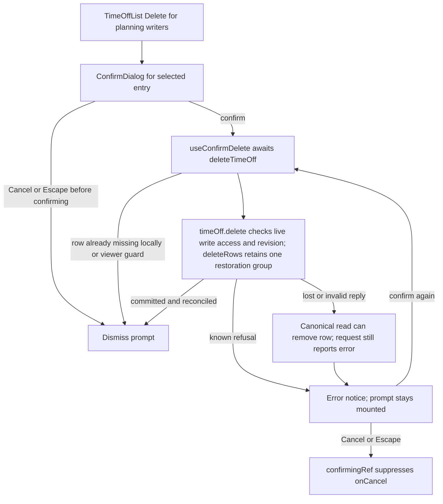

# US-TOF-03 — Delete a time-off entry (confirmed)

As an Editor, I want to confirm before deleting time off so that an accidental removal can be cancelled.

**Status:** Current

**Access:** Editor, Admin or Owner

**Entry:** Time off page

**Documentation:** [time-off.md](../../docs-src/using/time-off.md)

**Source:** [TimeOffForm.tsx](../../apps/frontend/src/components/time-off/TimeOffForm.tsx)

## Acceptance criteria

- **Delete {name} time off from {start} to {end}** opens **Delete time off?** (“Remove this time-off entry?”) with **Delete** and **Cancel**; Cancel preserves the entry.
- Confirming Delete removes the entry from the list and Schedule.

## User flow

## Code flow

An eligible Undo restores that individual row. The mounted prompt suppresses dismissal after a failed confirmed request, including a stale refusal that caused a refetch.

**Code references:**

- [TimeOffList.tsx](../../apps/frontend/src/components/time-off/TimeOffList.tsx#L171)
- [dialogs.tsx](../../apps/frontend/src/components/common/dialogs.tsx#L219)
- [useConfirmDelete.ts](../../apps/frontend/src/hooks/useConfirmDelete.ts#L4)
- [typedPlanningActions.ts](../../apps/frontend/src/store/typedPlanningActions.ts#L288)
- [execute.ts](../../apps/backend/app/services/planning/execute.ts#L395)
- [planning_mutations_controller.ts](../../apps/backend/app/controllers/planning_mutations_controller.ts#L9)
- [planning.ts](../../apps/backend/app/services/planning.ts#L198)
- [planningCache.ts](../../apps/frontend/src/data/planning/planningCache.ts#L471)
- [TimeOffList.test.tsx](../../apps/frontend/src/components/time-off/TimeOffList.test.tsx#L283)
