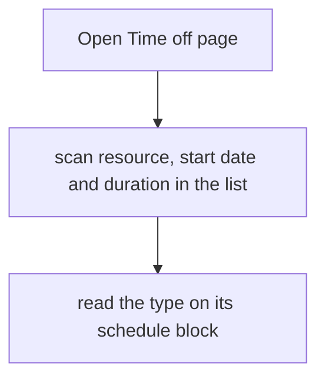
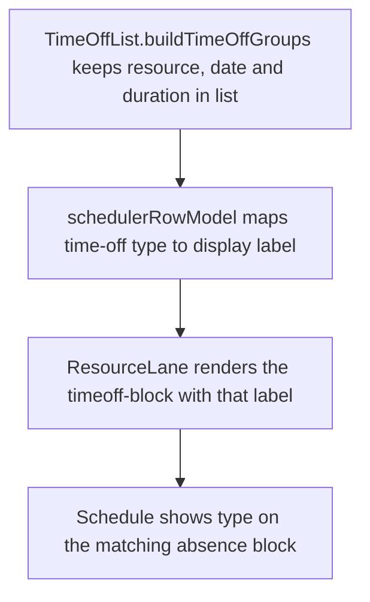

# US-TOF-04 — Time-off list reads terse; the type label lives on the timeline

As a company member, I want the time-off list to show who is away and for how long so that I can scan upcoming availability changes.

**Status:** Current

**Access:** Viewer, Editor, Admin or Owner

**Entry:** Time off page

**Documentation:** [time-off.md](../../docs-src/using/time-off.md)

**Source:** [TimeOffForm.tsx](../../apps/frontend/src/components/timeoff/TimeOffForm.tsx)

## Acceptance criteria

- The Time off list groups entries under each resource and shows each entry’s start date and length in days; it does not show the type.
- The Schedule block shows the type (Holiday, Sick, Unpaid or Other) when the block is wider than 44 pixels, and always exposes it to assistive technology.

## User flow

## Code flow

**Code references:**

- [TimeOffList.tsx](../../apps/frontend/src/components/timeoff/TimeOffList.tsx)
- [timeOffView.ts](../../apps/frontend/src/components/timeoff/timeOffView.ts)
- [schedulerRowModel.ts](../../apps/frontend/src/components/scheduler/schedulerRowModel.ts)
- [ResourceLane.tsx](../../apps/frontend/src/components/scheduler/ResourceLane.tsx)
