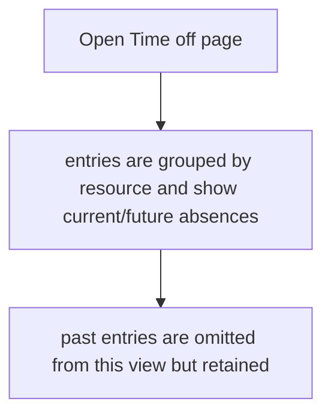
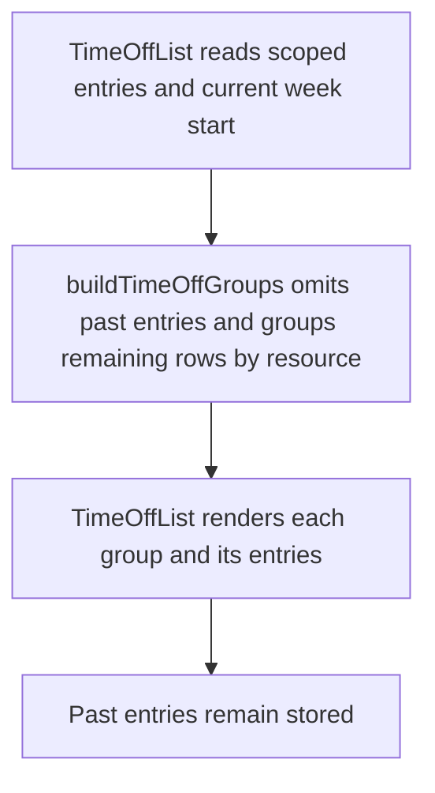

# US-TOF-05 — Scan current and future time off by resource

As a company member, I want current and future time off grouped by resource so that upcoming absences are easy to review.

**Status:** Current

**Access:** Viewer, Editor, Admin or Owner

**Entry:** Time off page

**Documentation:** [time-off.md](../../docs-src/using/time-off.md)

**Source:** [TimeOffForm.tsx](../../apps/frontend/src/components/timeoff/TimeOffForm.tsx)

## Acceptance criteria

- The Time off page groups entries by resource under **Personal time off**.
- Entries that ended before the start of the current week are hidden without being deleted; entries for placeholders are hidden while Show placeholders is off.

## User flow

## Code flow

**Code references:**

- [TimeOffList.tsx](../../apps/frontend/src/components/timeoff/TimeOffList.tsx)
- [timeOffView.ts](../../apps/frontend/src/components/timeoff/timeOffView.ts)
