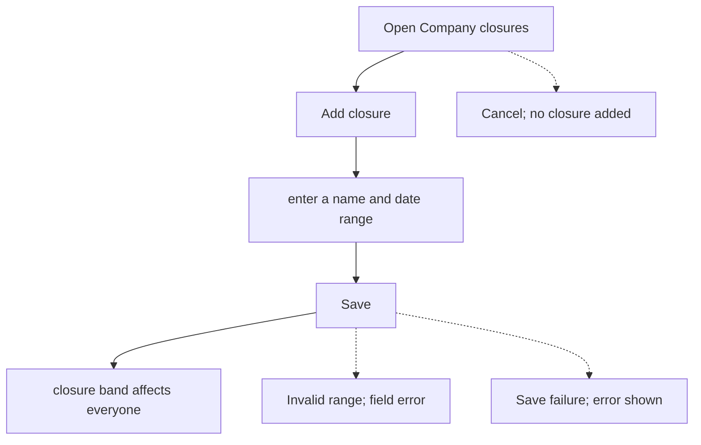
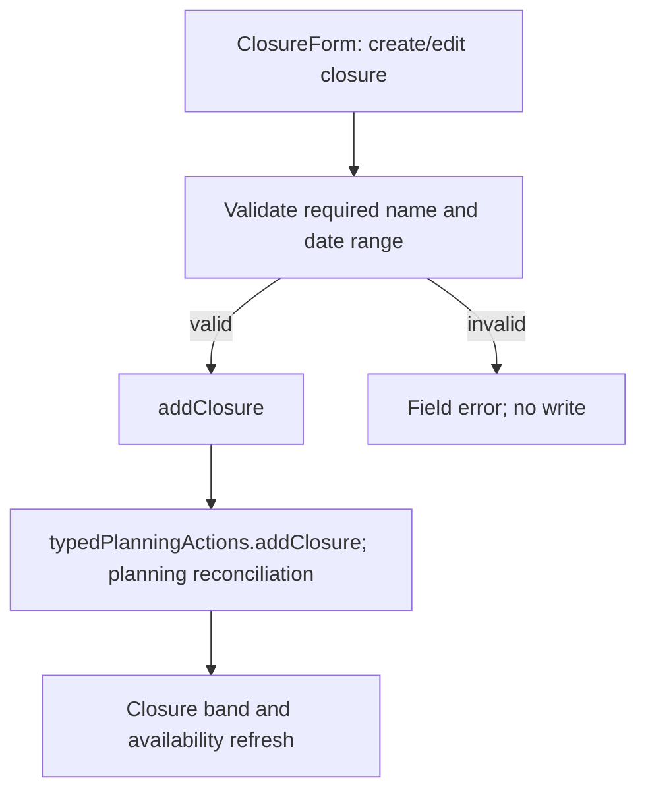

# US-TOF-06 — Record a named company closure

As an Editor, I want to record a company-wide closure so that people and placeholders share the same unavailable dates.

**Status:** Current
**Access:** Editor, Admin or Owner
**Entry:** Time off page
**Documentation:** [time-off.md](../../docs-src/using/time-off.md)
**Source:** [ClosureForm.tsx](../../apps/frontend/src/components/timeoff/ClosureForm.tsx)

## Acceptance criteria

| Field | Control    | Required/default/conditions                        |
| ----- | ---------- | -------------------------------------------------- |
| Name  | Text input | Required.                                          |
| Start | Date input | Required; defaults to today.                       |
| End   | Date input | Required; defaults to today; cannot precede Start. |

- Save creates the closure; Cancel leaves the schedule unchanged.

## User flow

## Code flow

**Code references:**

- [ClosureForm.tsx](../../apps/frontend/src/components/timeoff/ClosureForm.tsx)
- [typedPlanningActions.ts](../../apps/frontend/src/store/typedPlanningActions.ts)
- [planningCacheController.ts](../../apps/frontend/src/data/planning/planningCacheController.ts)
