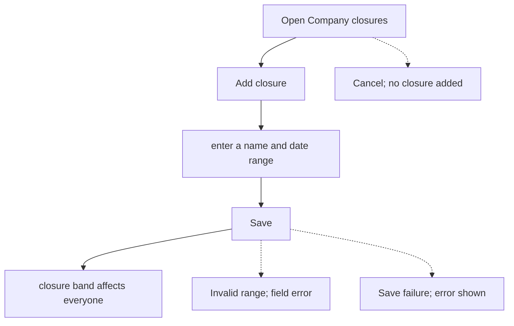
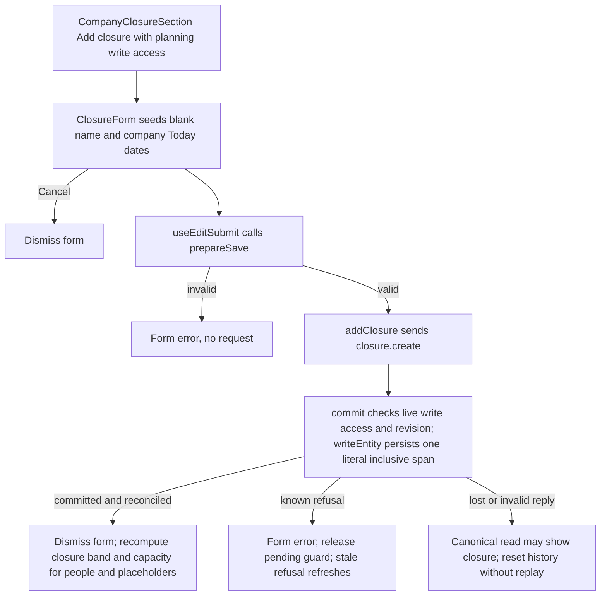

# US-TOF-06 — Record a named company closure

As an Editor, I want to record a company-wide closure so that people and placeholders share the same unavailable dates.

**Status:** Current
**Access:** Editor, Admin or Owner
**Entry:** Time off page
**Documentation:** [time-off.md](../../docs-src/using/time-off.md)
**Source:** [ClosureForm.tsx](../../apps/frontend/src/components/time-off/ClosureForm.tsx)

## Acceptance criteria

| Field | Control    | Required/default/conditions                        |
| ----- | ---------- | -------------------------------------------------- |
| Name  | Text input | Required.                                          |
| Start | Date input | Required; defaults to today.                       |
| End   | Date input | Required; defaults to today; cannot precede Start. |

- Save creates the closure; Cancel leaves the schedule unchanged.

## User flow

## Code flow

The pending form disables its fields and buttons during Save. Resource and Repeat controls are absent. The list shows the reconciled closure only when it ends in the current company week or later.

**Code references:**

- [CompanyClosureSection.tsx](../../apps/frontend/src/components/time-off/CompanyClosureSection.tsx#L76)
- [ClosureForm.tsx](../../apps/frontend/src/components/time-off/ClosureForm.tsx#L74)
- [ClosureForm.tsx](../../apps/frontend/src/components/time-off/ClosureForm.tsx#L103)
- [useEditSubmit.ts](../../apps/frontend/src/hooks/useEditSubmit.ts#L44)
- [typedPlanningActions.ts](../../apps/frontend/src/store/typedPlanningActions.ts#L293)
- [execute.ts](../../apps/backend/app/services/planning/execute.ts#L401)
- [timeOffView.ts](../../apps/frontend/src/components/time-off/timeOffView.ts#L24)
- [availability.ts](../../packages/shared/src/lib/capacity/availability.ts#L83)
- [planning_mutations_controller.ts](../../apps/backend/app/controllers/planning_mutations_controller.ts#L7)
- [planning.ts](../../apps/backend/app/services/planning.ts#L198)
- [planningCache.ts](../../apps/frontend/src/data/planning/planningCache.ts#L471)
- [ClosureForm.test.tsx](../../apps/frontend/src/components/time-off/ClosureForm.test.tsx#L51)
