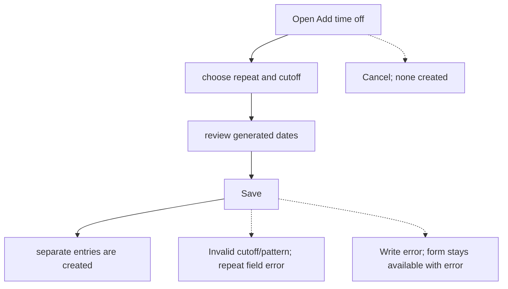
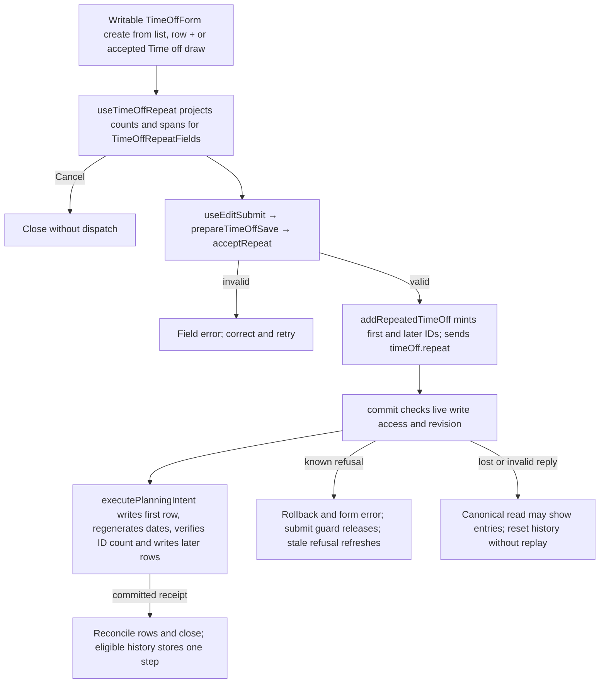

# US-TOF-07 — Create repeated personal time off

As an Editor, I want to create a finite batch of repeating time-off entries so that regular time off can be recorded in one form.

**Status:** Current
**Access:** Editor, Admin or Owner
**Entry:** Add time off form on the Time off page
**Documentation:** [time-off.md](../../docs-src/using/time-off.md)
**Source:** [TimeOffRepeatFields.tsx](../../apps/frontend/src/components/time-off/TimeOffRepeatFields.tsx), [timeOffFormSubmission.ts](../../apps/frontend/src/components/time-off/timeOffFormSubmission.ts)

## Acceptance criteria

| Field        | Control    | Required/default/conditions                                                                                                                                     |
| ------------ | ---------- | --------------------------------------------------------------------------------------------------------------------------------------------------------------- |
| Repeat       | Select     | Defaults to Doesn’t repeat; Weekly, Every 2 weeks, Every 3 weeks, Every 4 weeks, Monthly on day {day} or Monthly on the last {weekday}                          |
| Repeat until | Date input | Required when repeating; suggested and capped at the end of the eleventh calendar month after Start’s month; includes an occurrence starting on the cutoff date |

- Saving creates independent dated entries; each occurrence can be edited or deleted on its own.

## User flow

## Code flow

The entries have independent IDs and no series field. Edit or Delete acts on one entry. The rule counts inclusive start dates and preserves each entry’s duration.

**Code references:**

- [TimeOffList.tsx](../../apps/frontend/src/components/time-off/TimeOffList.tsx#L157)
- [SchedulerGridRow.tsx](../../apps/frontend/src/components/scheduler/SchedulerGridRow.tsx#L130)
- [SchedulerGrid.tsx](../../apps/frontend/src/components/scheduler/SchedulerGrid.tsx#L116)
- [useTimeOffRepeat.ts](../../apps/frontend/src/components/time-off/useTimeOffRepeat.ts#L26)
- [TimeOffRepeatFields.tsx](../../apps/frontend/src/components/time-off/TimeOffRepeatFields.tsx#L27)
- [timeOffFormSubmission.ts](../../apps/frontend/src/components/time-off/timeOffFormSubmission.ts#L76)
- [typedPlanningActions.ts](../../apps/frontend/src/store/typedPlanningActions.ts#L244)
- [planning_execution_service.ts](../../apps/backend/app/services/planning/planning_execution_service.ts#L341)
- [inverse.ts](../../apps/backend/app/services/planning/inverse.ts#L45)
- [planning_mutations_controller.ts](../../apps/backend/app/controllers/planning_mutations_controller.ts#L9)
- [planning_service.ts](../../apps/backend/app/services/planning_service.ts#L222)
- [planningCache.ts](../../apps/frontend/src/data/planning/planningCache.ts#L471)
- [TimeOffForm.repeat.test.tsx](../../apps/frontend/src/components/time-off/TimeOffForm.repeat.test.tsx#L167)
