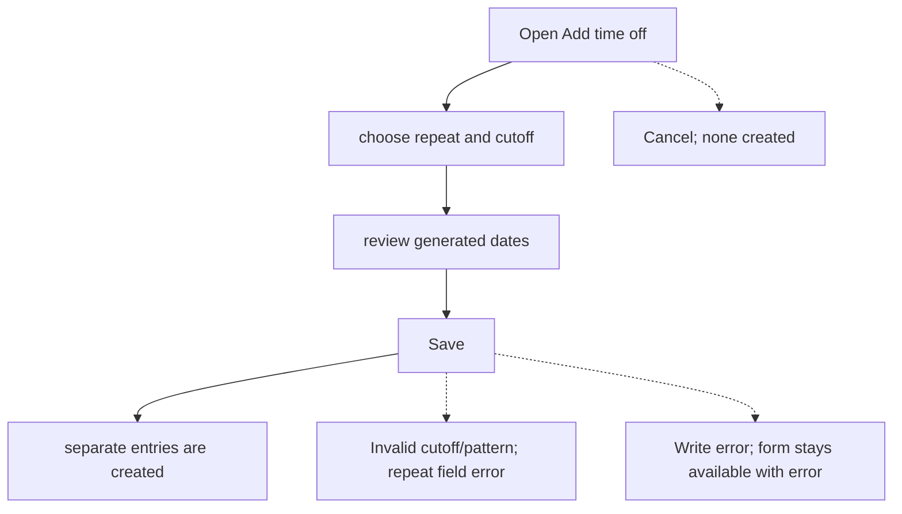
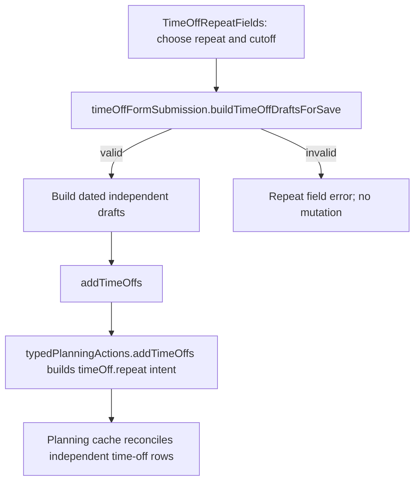

# US-TOF-07 — Create repeated personal time off

As an Editor, I want to create a finite batch of repeating time-off entries so that regular absences can be recorded in one form.

**Status:** Current
**Access:** Editor, Admin or Owner
**Entry:** Add time off form on the Time off page
**Documentation:** [time-off.md](../../docs-src/using/time-off.md)
**Source:** [TimeOffRepeatFields.tsx](../../apps/frontend/src/components/timeoff/TimeOffRepeatFields.tsx), [timeOffFormSubmission.ts](../../apps/frontend/src/components/timeoff/timeOffFormSubmission.ts)

## Acceptance criteria

| Field        | Control    | Required/default/conditions                                                                                                       |
| ------------ | ---------- | --------------------------------------------------------------------------------------------------------------------------------- |
| Repeat       | Select     | Defaults to Doesn’t repeat; offers weekly, every two/three/four weeks, monthly on date or monthly on last weekday.                |
| Repeat until | Date input | Required when repeating; suggested from Start; maximum is limited from Start; includes an occurrence starting on the cutoff date. |

- Saving creates independent dated entries; each occurrence can be edited or deleted on its own.

## User flow

## Code flow

**Code references:**

- [TimeOffForm.tsx](../../apps/frontend/src/components/timeoff/TimeOffForm.tsx)
- [TimeOffRepeatFields.tsx](../../apps/frontend/src/components/timeoff/TimeOffRepeatFields.tsx)
- [timeOffFormSubmission.ts](../../apps/frontend/src/components/timeoff/timeOffFormSubmission.ts)
- [typedPlanningActions.ts](../../apps/frontend/src/store/typedPlanningActions.ts)
- [planningCacheController.ts](../../apps/frontend/src/data/planning/planningCacheController.ts)
