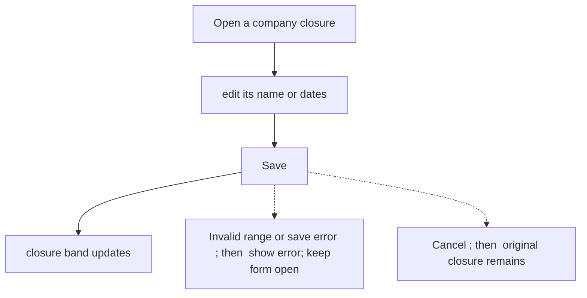
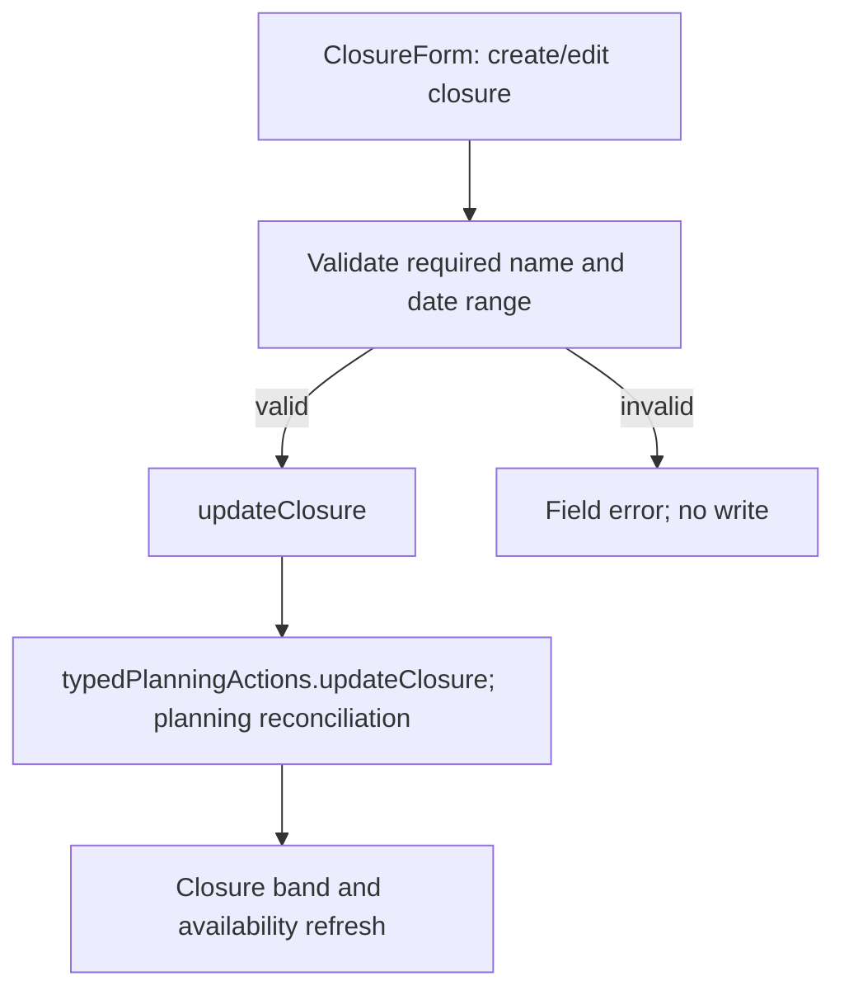

# US-TOF-08 — Edit a company closure

As an Editor, I want to update a company closure so that its name and dates reflect the current company calendar.

**Status:** Current

**Access:** Editor, Admin or Owner

**Entry:** Time off page, Company closures section

**Documentation:** [time-off.md](../../docs-src/using/time-off.md)

**Source:** [ClosureForm.tsx](../../apps/frontend/src/components/timeoff/ClosureForm.tsx)

## Acceptance criteria

| Field | Control    | Required/default/conditions                                        |
| ----- | ---------- | ------------------------------------------------------------------ |
| Name  | Text input | Required; prefilled with the saved name.                           |
| Start | Date input | Required; prefilled with the saved start date.                     |
| End   | Date input | Required; prefilled with the saved end date; cannot precede Start. |

- Save updates the closure; Cancel leaves it unchanged.

## User flow

## Code flow

**Code references:**

- [ClosureForm.tsx](../../apps/frontend/src/components/timeoff/ClosureForm.tsx)
- [typedPlanningActions.ts](../../apps/frontend/src/store/typedPlanningActions.ts)
- [planningCacheController.ts](../../apps/frontend/src/data/planning/planningCacheController.ts)
