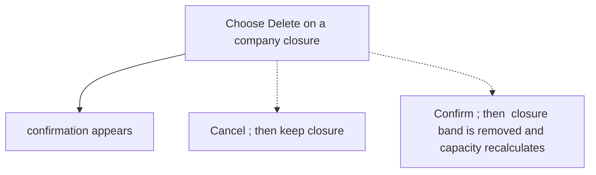
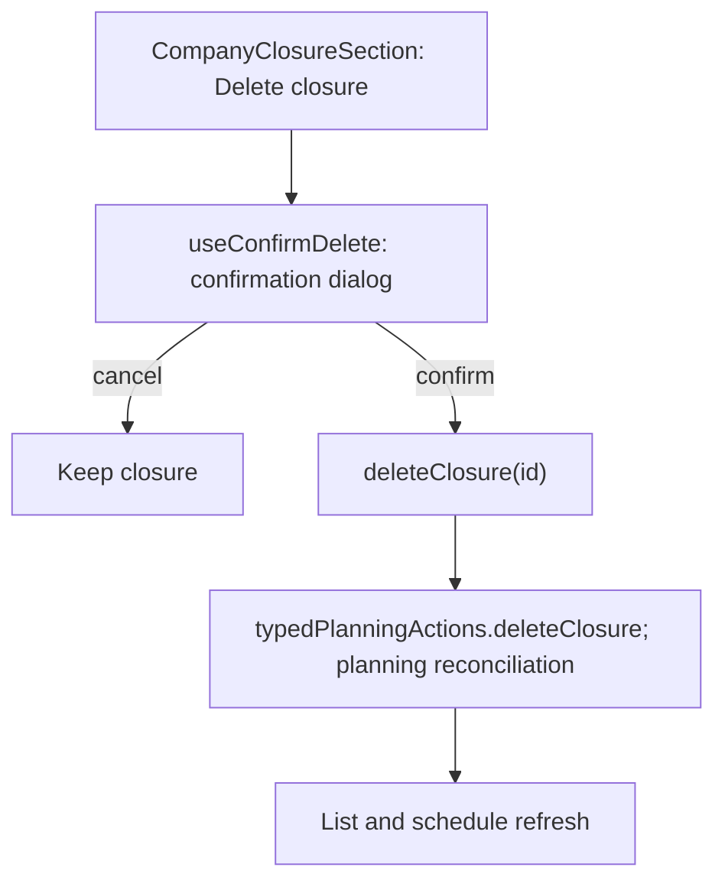

# US-TOF-09 — Delete a company closure

As an Editor, I want to remove a company closure so that its dates no longer reduce available capacity.

**Status:** Current

**Access:** Editor, Admin or Owner

**Entry:** Time off page, Company closures section

**Documentation:** [time-off.md](../../docs-src/using/time-off.md)

**Source:** [CompanyClosureSection.tsx](../../apps/frontend/src/components/timeoff/CompanyClosureSection.tsx)

## Acceptance criteria

- **Delete** asks for confirmation; Cancel keeps the closure.
- Confirming Delete removes the closure band and restores availability on its dates.

## User flow

## Code flow

**Code references:**

- [CompanyClosureSection.tsx](../../apps/frontend/src/components/timeoff/CompanyClosureSection.tsx)
- [useConfirmDelete.ts](../../apps/frontend/src/hooks/useConfirmDelete.ts)
- [typedPlanningActions.ts](../../apps/frontend/src/store/typedPlanningActions.ts)
- [planningCacheController.ts](../../apps/frontend/src/data/planning/planningCacheController.ts)
