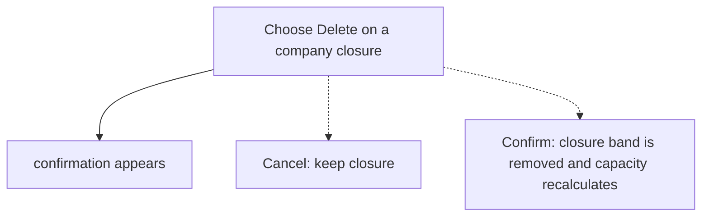
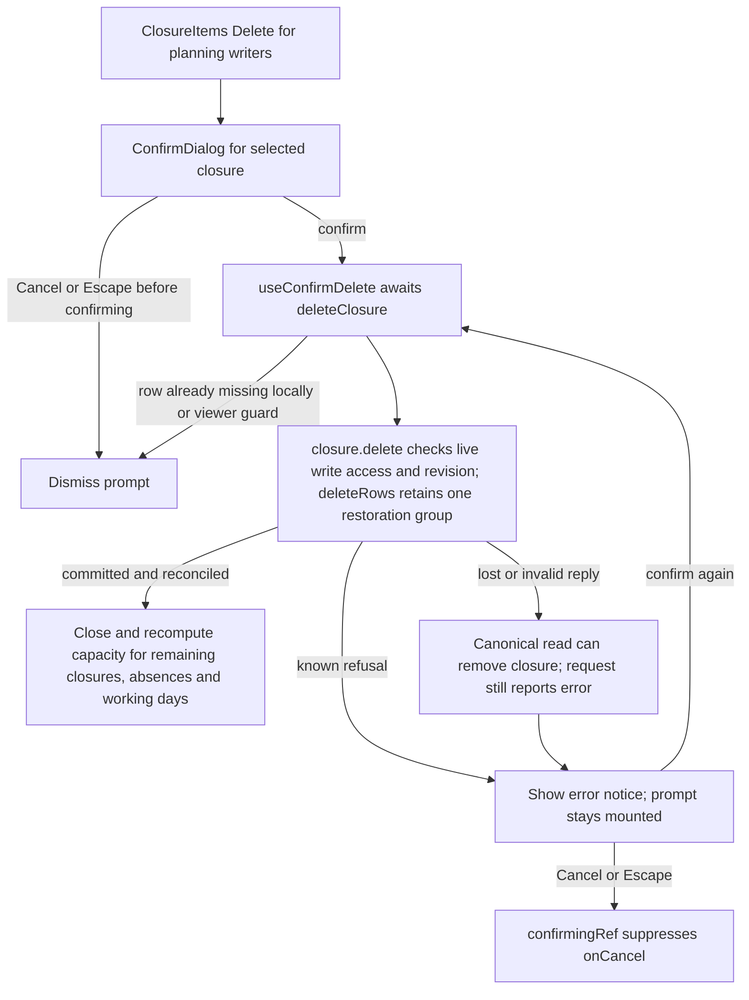

# US-TOF-09 — Delete a company closure

As an Editor, I want to remove a company closure so that its dates no longer reduce available capacity.

**Status:** Current

**Access:** Editor, Admin or Owner

**Entry:** Time off page, Company closures section

**Documentation:** [time-off.md](../../docs-src/using/time-off.md)

**Source:** [CompanyClosureSection.tsx](../../apps/frontend/src/components/time-off/CompanyClosureSection.tsx)

## Acceptance criteria

- **Delete {name} closure, {range}** opens **Delete closure?** (“Remove this company closure?”) with **Delete** and **Cancel**; Cancel keeps the closure.
- Confirming Delete removes the closure band and restores availability on its dates.

## User flow

## Code flow

**Code references:**

- [CompanyClosureSection.tsx](../../apps/frontend/src/components/time-off/CompanyClosureSection.tsx#L114)
- [dialogs.tsx](../../apps/frontend/src/components/common/dialogs.tsx#L219)
- [useConfirmDelete.ts](../../apps/frontend/src/hooks/useConfirmDelete.ts#L4)
- [typedPlanningActions.ts](../../apps/frontend/src/store/typedPlanningActions.ts#L326)
- [planning_execution_service.ts](../../apps/backend/app/services/planning/planning_execution_service.ts#L389)
- [availability.ts](../../packages/shared/src/lib/capacity/availability.ts#L92)
- [planning_mutations_controller.ts](../../apps/backend/app/controllers/planning_mutations_controller.ts#L9)
- [planning_service.ts](../../apps/backend/app/services/planning_service.ts#L222)
- [planningCache.ts](../../apps/frontend/src/data/planning/planningCache.ts#L471)
- [CompanyClosureSection.test.tsx](../../apps/frontend/src/components/time-off/CompanyClosureSection.test.tsx#L109)
