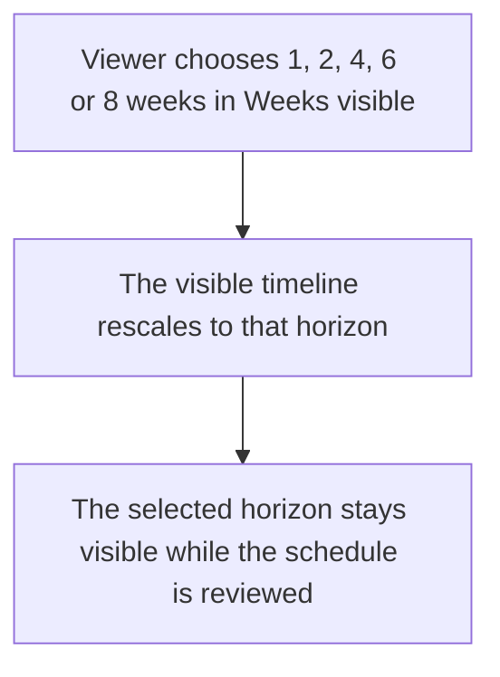
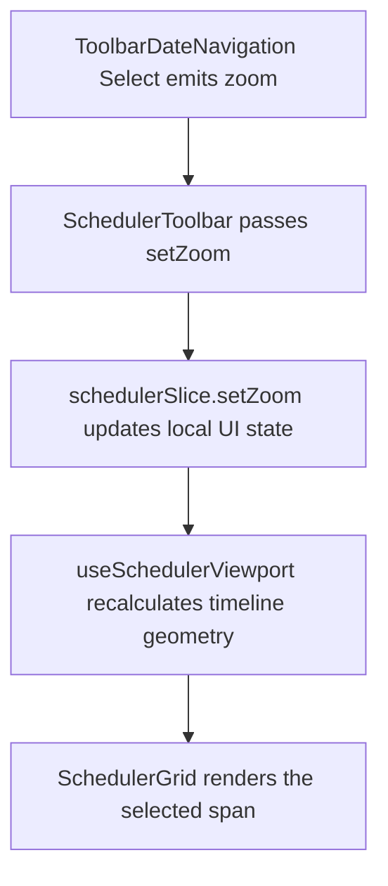

# US-TBR-01 — Zoom the timeline (1/2/4/6/8 weeks)

As an Editor, I want to choose how many weeks are visible so that I can trade timeline detail for a broader view.

**Status:** Current

**Access:** Viewer, Editor, Admin or Owner

**Entry:** Schedule (`/`)

**Documentation:** [schedule-work.md](../../docs-src/using/schedule-work.md)

**Source:** [SchedulerToolbar.tsx](../../apps/frontend/src/components/scheduler/SchedulerToolbar.tsx)

## Acceptance criteria

- **Weeks visible** offers 1, 2, 4, 6 or 8 weeks.
- Choosing a span resizes the visible timeline without changing allocations.

## User flow

## Code flow

**Code references:** [ToolbarDateNavigation.tsx](../../apps/frontend/src/components/scheduler/ToolbarDateNavigation.tsx), [SchedulerToolbar.tsx](../../apps/frontend/src/components/scheduler/SchedulerToolbar.tsx), [schedulerSlice.ts](../../apps/frontend/src/store/slices/schedulerSlice.ts), [useSchedulerViewport.ts](../../apps/frontend/src/components/scheduler/useSchedulerViewport.ts), [SchedulerGrid.tsx](../../apps/frontend/src/components/scheduler/SchedulerGrid.tsx)
