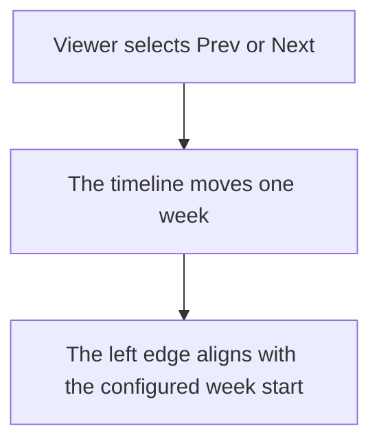
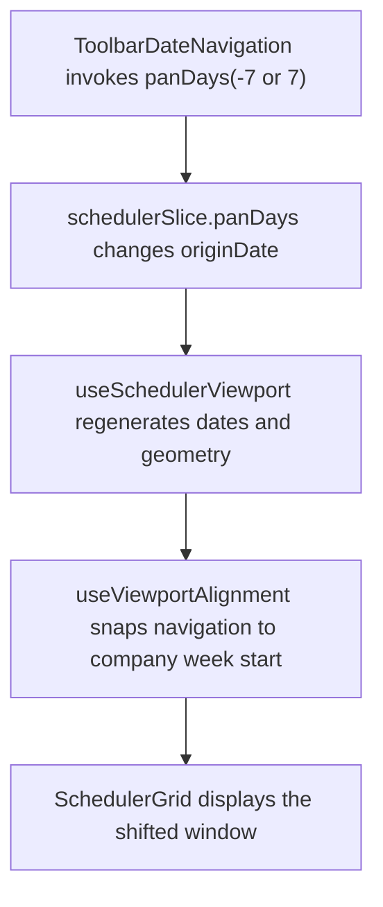

# US-TBR-02 — Pan a week back / forward

As an Editor, I want to pan one week backward or forward so that I can move through the schedule in manageable steps.

**Status:** Current

**Access:** Viewer, Editor, Admin or Owner

**Entry:** Schedule (`/`)

**Documentation:** [schedule-work.md](../../docs-src/using/schedule-work.md)

**Source:** [SchedulerToolbar.tsx](../../apps/frontend/src/components/scheduler/SchedulerToolbar.tsx)

## Acceptance criteria

- **Prev** and **Next** move the schedule window by one week.
- The icon-only controls have accessible names.

## User flow

## Code flow

**Code references:** [ToolbarDateNavigation.tsx](../../apps/frontend/src/components/scheduler/ToolbarDateNavigation.tsx), [SchedulerToolbar.tsx](../../apps/frontend/src/components/scheduler/SchedulerToolbar.tsx), [schedulerSlice.ts](../../apps/frontend/src/store/slices/schedulerSlice.ts), [useSchedulerViewport.ts](../../apps/frontend/src/components/scheduler/useSchedulerViewport.ts), [SchedulerGrid.tsx](../../apps/frontend/src/components/scheduler/SchedulerGrid.tsx)
