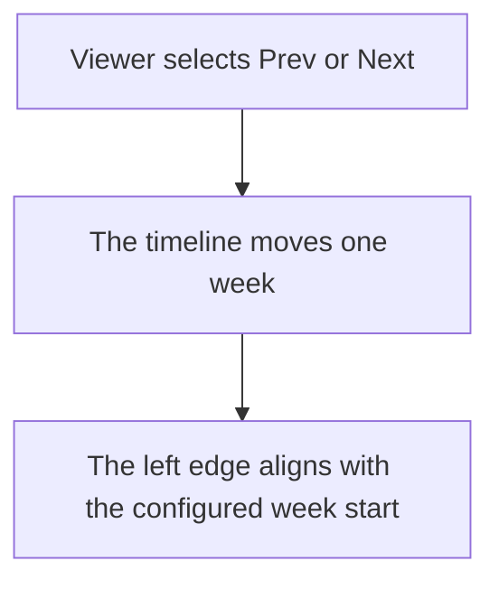
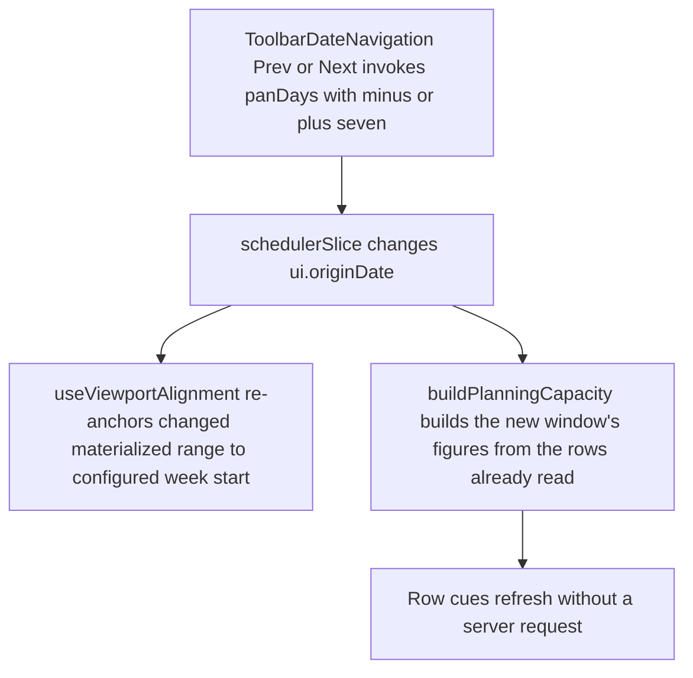

# US-TBR-02 — Pan a week back / forward

As an Editor, I want to pan one week backward or forward so that I can move through the schedule in manageable steps.

**Status:** Current

**Access:** Viewer, Editor, Admin or Owner

**Entry:** Schedule (`/`)

**Documentation:** [schedule-work.md](../../docs-src/using/schedule-work.md)

**Source:** [SchedulerToolbar.tsx](../../apps/frontend/src/components/scheduler/SchedulerToolbar.tsx)

## Acceptance criteria

- **Prev** ("Back one week") and **Next** ("Forward one week") move the schedule window by seven days.
- The icon-only controls are named **Prev** and **Next** for assistive technology.

## User flow

## Code flow

Prev and Next are available to Schedule readers. The action changes display state only; it sends no request.

**Code references:**

- [ToolbarDateNavigation.tsx](../../apps/frontend/src/components/scheduler/ToolbarDateNavigation.tsx#L35)
- [schedulerSlice.ts](../../apps/frontend/src/store/slices/schedulerSlice.ts#L195)
- [useSchedulerViewport.ts](../../apps/frontend/src/components/scheduler/useSchedulerViewport.ts#L183)
- [useStore.ts](../../apps/frontend/src/store/useStore.ts#L63)
- [schedulerRowModel.ts](../../apps/frontend/src/components/scheduler/schedulerRowModel.ts#L120)
