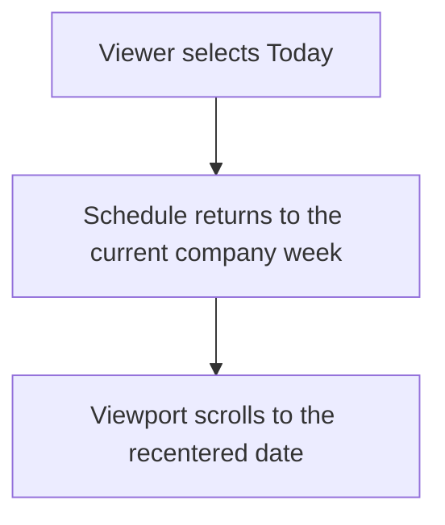
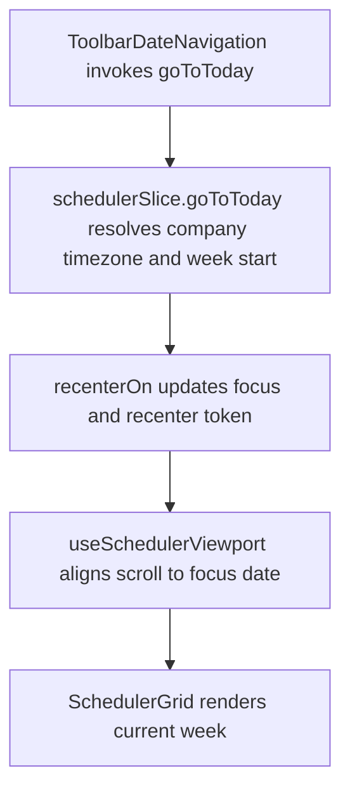

# US-TBR-03 — Re-centre on Today

As an Editor, I want Today to recenter the timeline so that I can return to the current planning period.

**Status:** Current

**Access:** Viewer, Editor, Admin or Owner

**Entry:** Schedule (`/`)

**Documentation:** [schedule-work.md](../../docs-src/using/schedule-work.md)

**Source:** [SchedulerToolbar.tsx](../../apps/frontend/src/components/scheduler/SchedulerToolbar.tsx)

## Acceptance criteria

- **Today** returns the schedule to the start of the current week in the company time zone.

## User flow

## Code flow

**Code references:** [ToolbarDateNavigation.tsx](../../apps/frontend/src/components/scheduler/ToolbarDateNavigation.tsx), [SchedulerToolbar.tsx](../../apps/frontend/src/components/scheduler/SchedulerToolbar.tsx), [schedulerSlice.ts](../../apps/frontend/src/store/slices/schedulerSlice.ts), [storeInternal.ts](../../apps/frontend/src/store/storeInternal.ts), [useSchedulerViewport.ts](../../apps/frontend/src/components/scheduler/useSchedulerViewport.ts)
