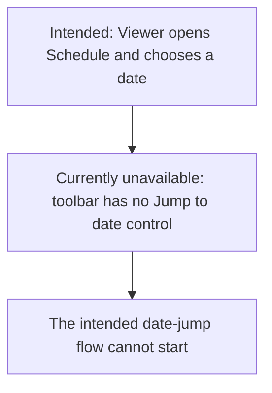
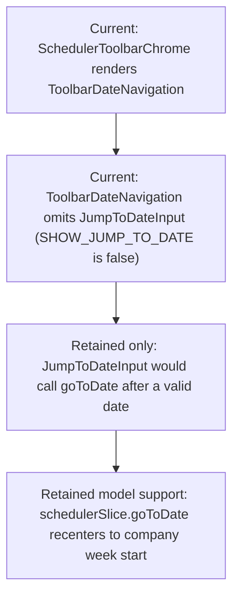

# US-TBR-04 — Jump to a specific date (hidden from the toolbar)

As an Editor, I want to jump to a selected date so that I can inspect a specific future period; the toolbar control is currently hidden.

**Status:** Hidden — the date picker remains in code but the toolbar does not render it; redesign is deferred.

**Access:** Viewer, Editor, Admin or Owner

**Entry:** Schedule (`/`)

**Documentation:** [schedule-work.md](../../docs-src/using/schedule-work.md)

**Source:** [ToolbarDateNavigation.tsx](../../apps/frontend/src/components/scheduler/ToolbarDateNavigation.tsx), [JumpToDateInput.tsx](../../apps/frontend/src/components/scheduler/JumpToDateInput.tsx)

## Acceptance criteria

| Field        | Control           | Required/default/conditions                                                                                                        |
| ------------ | ----------------- | ---------------------------------------------------------------------------------------------------------------------------------- |
| Jump to date | Native date input | Hidden from the current toolbar; when exposed, shows the focused date and repositions the schedule after a valid date is selected. |

## User flow

## Code flow

**Code references:** [SchedulerToolbarSections.tsx](../../apps/frontend/src/components/scheduler/SchedulerToolbarSections.tsx), [ToolbarDateNavigation.tsx](../../apps/frontend/src/components/scheduler/ToolbarDateNavigation.tsx), [JumpToDateInput.tsx](../../apps/frontend/src/components/scheduler/JumpToDateInput.tsx), [schedulerSlice.ts](../../apps/frontend/src/store/slices/schedulerSlice.ts)
