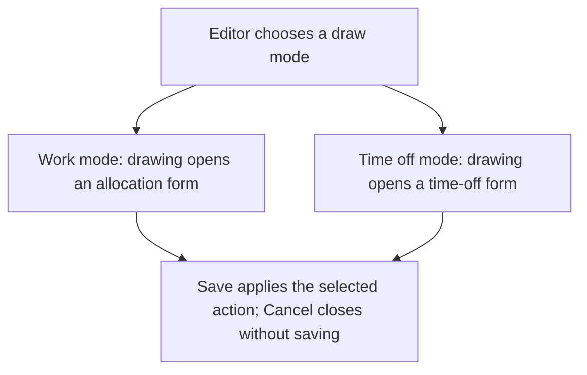
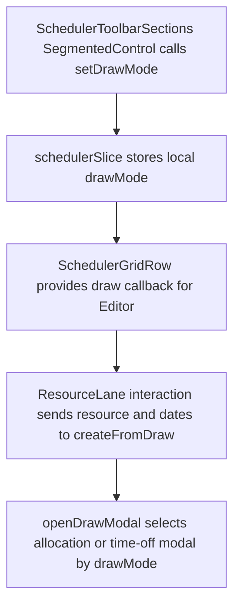

# US-TBR-05 — Switch Work / Time-off draw mode

As an Editor, I want to switch between Work and Time off draw modes so that a lane gesture opens the matching form.

**Status:** Current

**Access:** Editor, Admin or Owner

**Entry:** Schedule (`/`)

**Documentation:** [schedule-work.md](../../docs-src/using/schedule-work.md)

**Source:** [SchedulerToolbar.tsx](../../apps/frontend/src/components/scheduler/SchedulerToolbar.tsx)

## Acceptance criteria

- Editors see a **Draw mode** control with **Work** (the default) and **Time off**.
- In Work mode, drawing across a resource lane opens the allocation form with that resource and date range. In Time off mode it opens the time-off form instead, allocation bars cannot be selected or dragged, and drawing on an external resource opens nothing.
- A draw that starts on a day the resource does not work or has time off opens nothing; in Work mode a closure day also blocks it.

## User flow

## Code flow

**Code references:** [SchedulerToolbarSections.tsx](../../apps/frontend/src/components/scheduler/SchedulerToolbarSections.tsx), [schedulerSlice.ts](../../apps/frontend/src/store/slices/schedulerSlice.ts), [SchedulerGridRow.tsx](../../apps/frontend/src/components/scheduler/SchedulerGridRow.tsx), [ResourceLane.tsx](../../apps/frontend/src/components/scheduler/ResourceLane.tsx), [useResourceLaneInteraction.ts](../../apps/frontend/src/components/scheduler/useResourceLaneInteraction.ts), [SchedulerGrid.tsx](../../apps/frontend/src/components/scheduler/SchedulerGrid.tsx)
