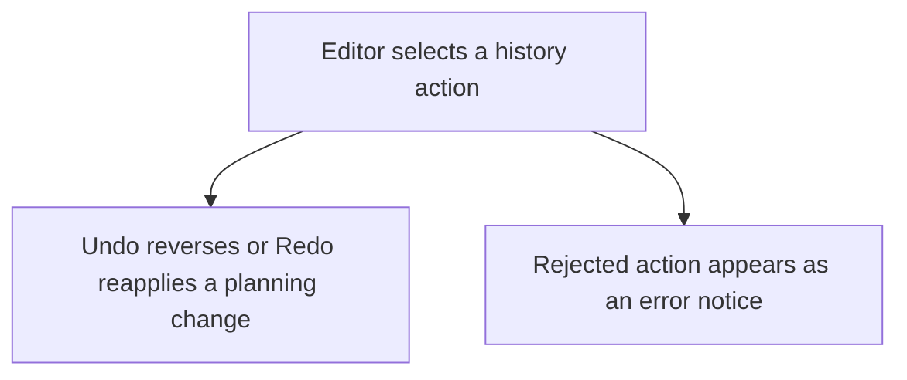
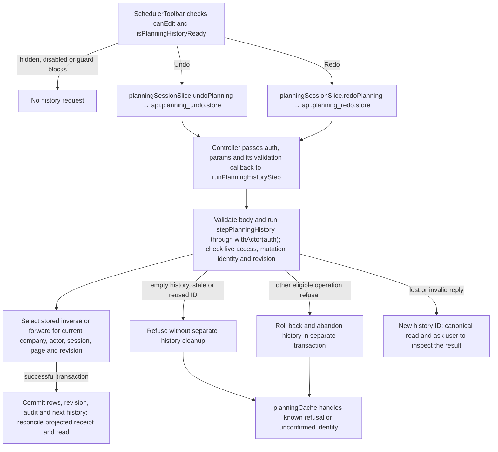

# US-TBR-06 — Undo / Redo toolbar buttons

As an Editor, I want toolbar Undo and Redo controls so that I can reverse or reapply a planning change without a keyboard shortcut.

**Status:** Current

**Access:** Editor, Admin or Owner

**Entry:** Schedule (`/`)

**Documentation:** [schedule-work.md](../../docs-src/using/schedule-work.md)

**Source:** [SchedulerToolbar.tsx](../../apps/frontend/src/components/scheduler/SchedulerToolbar.tsx)

## Acceptance criteria

- **Undo** and **Redo** reverse and reapply acknowledged planning changes.
- History belongs to one page and sign-in. It survives a refetch at the same revision and ends on a reload, another person's change, a lost reply, a refused step, a change that cannot be reversed, a privacy, code-name or activity-kind change, anonymisation and import. There is no cross-device undo.
- The buttons appear only for Editor or higher. Each is disabled while planning history is not ready or when it has nothing to undo or redo.

## User flow

## Code flow

The server keeps up to 50 entries for the last writer. A stale refusal refetches without a second toolbar toast. Ordinary failures outside the cache’s existing error notice surface through the toolbar. See the [signed-in request boundary](../REFERENCE.md#signed-in-requests) for both the history step and its separate cleanup transaction.

**Code references:**

- [SchedulerToolbar.tsx](../../apps/frontend/src/components/scheduler/SchedulerToolbar.tsx#L14)
- [SchedulerToolbarSections.tsx](../../apps/frontend/src/components/scheduler/SchedulerToolbarSections.tsx#L54)
- [planningReadiness.ts](../../apps/frontend/src/data/planning/planningReadiness.ts#L14)
- [planningSessionSlice.ts](../../apps/frontend/src/store/slices/planningSessionSlice.ts#L200)
- [planningCache.ts](../../apps/frontend/src/data/planning/planningCache.ts#L624)
- [planningTransport.ts](../../apps/frontend/src/data/planning/planningTransport.ts#L136)
- [planning_undo_controller.ts](../../apps/backend/app/controllers/planning_undo_controller.ts#L5)
- [planning_redo_controller.ts](../../apps/backend/app/controllers/planning_redo_controller.ts#L5)
- [history_step.ts](../../apps/backend/app/services/planning/history_step.ts#L9)
- [planning.ts](../../apps/backend/app/services/planning.ts#L206)
- [planningCache.ts](../../apps/frontend/src/data/planning/planningCache.ts#L530)
- [history.spec.ts](../../apps/backend/tests/functional/planning/history.spec.ts#L113)
- [SchedulerToolbar.test.tsx](../../apps/frontend/src/components/scheduler/SchedulerToolbar.test.tsx#L456)
