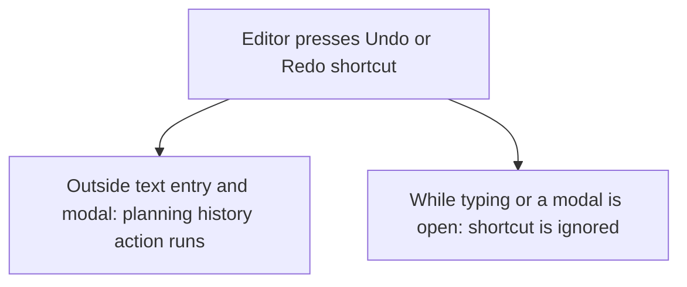
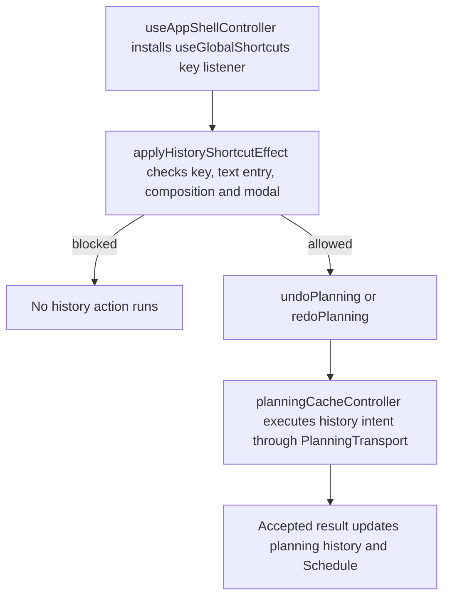

# US-TBR-07 — Undo / Redo with ⌘Z / ⌘⇧Z

As an Editor, I want keyboard shortcuts for Undo and Redo so that I can reverse planning changes quickly while preserving text entry.

**Status:** Current

**Access:** Editor, Admin or Owner

**Entry:** Schedule (`/`)

**Documentation:** [schedule-work.md](../../docs-src/using/schedule-work.md)

**Source:** [SchedulerToolbar.tsx](../../apps/frontend/src/components/scheduler/SchedulerToolbar.tsx)

## Acceptance criteria

- ⌘Z / Ctrl+Z undo and ⌘⇧Z / Ctrl+Shift+Z redo planning changes.
- Shortcuts do not run while text entry, IME composition or a modal owns input.

## User flow

## Code flow

**Code references:** [useAppShellController.ts](../../apps/frontend/src/components/useAppShellController.ts), [allocationSlice.ts](../../apps/frontend/src/store/slices/allocationSlice.ts), [planningCacheController.ts](../../apps/frontend/src/data/planning/planningCacheController.ts), [planningTransport.ts](../../apps/frontend/src/data/planning/planningTransport.ts), [volatilePlanningTransport.ts](../../apps/frontend/src/data/planning/volatilePlanningTransport.ts)
