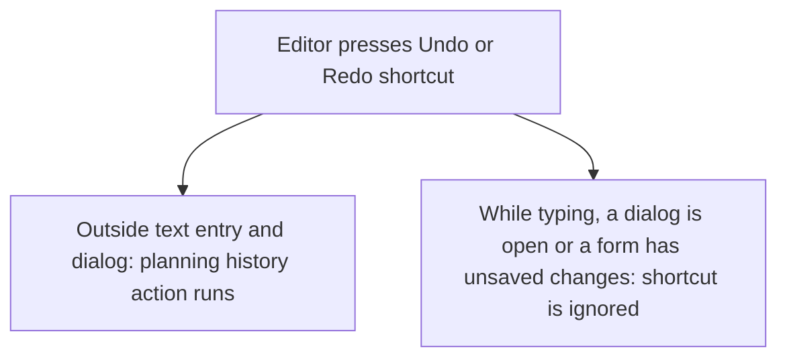
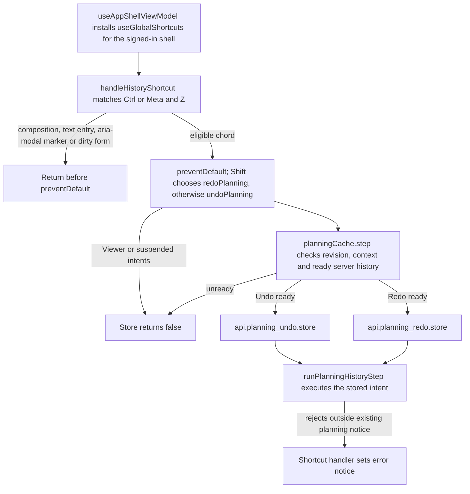

# US-TBR-07 — Undo / Redo with ⌘Z / ⌘⇧Z

As an Editor, I want keyboard shortcuts for Undo and Redo so that I can reverse planning changes quickly while preserving text entry.

**Status:** Current

**Access:** Editor, Admin or Owner

**Entry:** Schedule (`/`)

**Documentation:** [schedule-work.md](../../docs-src/using/schedule-work.md)

**Source:** [SchedulerToolbar.tsx](../../apps/frontend/src/components/scheduler/SchedulerToolbar.tsx)

## Acceptance criteria

- ⌘Z / Ctrl+Z undo and ⌘⇧Z / Ctrl+Shift+Z redo planning changes.
- The shortcuts work on every app screen. They do not run while text entry, IME composition or a dialog owns input, or while a form has unsaved changes.

## User flow

## Code flow

The dialog check matches an explicit `aria-modal="true"` marker. The shared confirmation wrapper supplies no such marker. [US-TBR-06](US-TBR-06-undo-redo-buttons.md) traces `runPlanningHistoryStep` through the committed receipt, refusal and unconfirmed recovery.

**Code references:**

- [useAppShellViewModel.ts](../../apps/frontend/src/components/useAppShellViewModel.ts#L50)
- [globalShortcuts.ts](../../apps/frontend/src/components/app-shell/globalShortcuts.ts#L33)
- [shortcutFilters.ts](../../apps/frontend/src/lib/shortcutFilters.ts#L19)
- [dialogs.tsx](../../apps/frontend/src/components/common/dialogs.tsx#L81)
- [alert-dialog.tsx](../../apps/frontend/src/components/ui/alert-dialog.tsx#L61)
- [AppShell.keyboard.test.tsx](../../apps/frontend/src/components/AppShell.keyboard.test.tsx#L98)
- [planningSessionSlice.ts](../../apps/frontend/src/store/slices/planningSessionSlice.ts#L200)
- [planningCache.ts](../../apps/frontend/src/data/planning/planningCache.ts#L624)
- [planningTransport.ts](../../apps/frontend/src/data/planning/planningTransport.ts#L136)
- [planning_history_step_service.ts](../../apps/backend/app/services/planning/planning_history_step_service.ts#L20)
