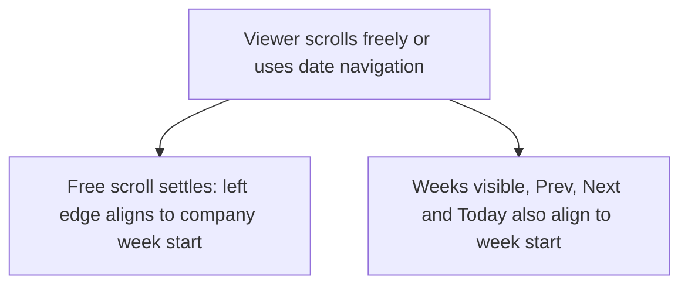
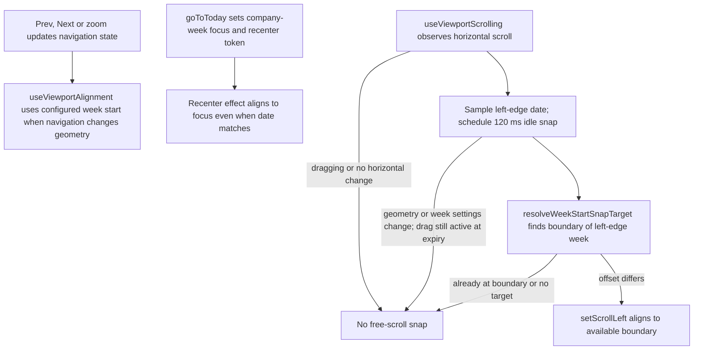

# US-TBR-08 — Navigation re-anchors the left edge to the week start

As an Editor, I want navigation to align the Schedule with the configured week start so that week boundaries stay consistent.

**Status:** Current

**Access:** Viewer, Editor, Admin or Owner

**Entry:** Schedule (`/`)

**Documentation:** [schedule-work.md](../../docs-src/using/schedule-work.md)

**Source:** [SchedulerToolbar.tsx](../../apps/frontend/src/components/scheduler/SchedulerToolbar.tsx)

## Acceptance criteria

- Weeks visible, Prev, Next and Today align the timeline to the configured week start.
- Free scrolling also snaps back to the configured week start when scrolling settles.

## User flow

## Code flow

Production enables free-scroll snapping. The switch is a test override.

**Code references:**

- [schedulerSlice.ts](../../apps/frontend/src/store/slices/schedulerSlice.ts#L199)
- [useSchedulerViewport.ts](../../apps/frontend/src/components/scheduler/useSchedulerViewport.ts#L156)
- [useSchedulerViewport.ts](../../apps/frontend/src/components/scheduler/useSchedulerViewport.ts#L216)
- [useSchedulerViewport.ts](../../apps/frontend/src/components/scheduler/useSchedulerViewport.ts#L279)
- [resolveWeekStartSnapTarget.ts](../../apps/frontend/src/components/scheduler/resolveWeekStartSnapTarget.ts#L19)
- [schedulerConfig.ts](../../apps/frontend/src/lib/schedulerConfig.ts#L33)
- [useSchedulerGridModel.ts](../../apps/frontend/src/components/scheduler/useSchedulerGridModel.ts#L169)
- [useSchedulerViewport.test.tsx](../../apps/frontend/src/components/scheduler/useSchedulerViewport.test.tsx#L182)
